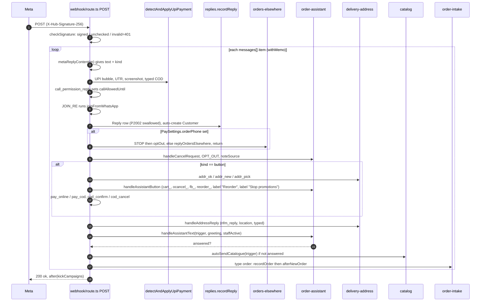
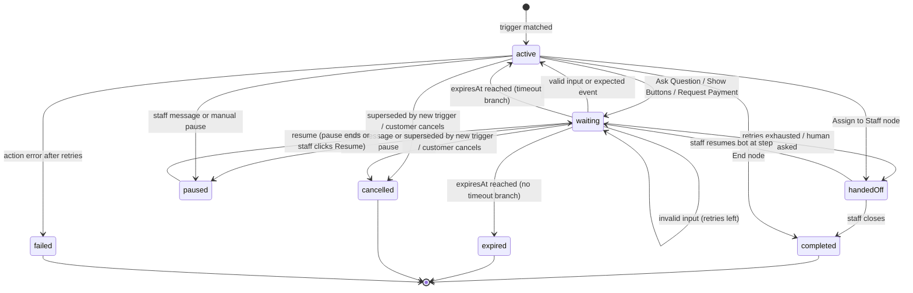
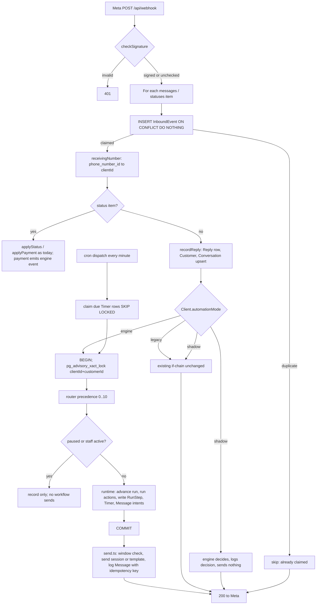
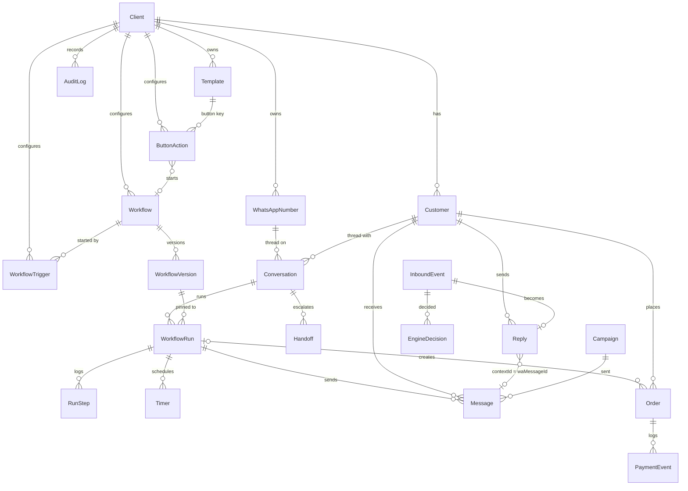

# Route Every WhatsApp Tap Through Tenant Mappings

Thabaal can build a configurable button-and-reply engine on Meta's Cloud API today, but only for **reply-type interactions**: template quick replies, session reply buttons, list rows, address and Flow form submissions, location shares, call-permission answers and catalogue carts each arrive as an inbound webhook that the server can act on. URL, phone, copy-code, OTP, catalogue-open and voice-call taps never reach the server, so they cannot trigger an automatic reply. The repository already handles roughly fifteen of these journeys (order assistant, cart intake, delivery address, payment choice, COD, cancel, feedback, reorder, orders-on-another-number, catalogue welcome, nudges, refill, win-back, JOIN opt-in, call permission), but every one is hand-coded in TypeScript inside a single `if` chain in `src/app/api/webhook/route.ts`. Routing relies on string prefixes and on **button label text**, because `sendTemplateMessage` never sends a quick-reply payload. The core recommendation is to put a **tenant-owned mapping layer** between "what Meta tells us was tapped" and "what Thabaal does". The action is decided by the saved mapping keyed on stable button IDs and the `context.id` of the tapped message, never by the label. A small, versioned workflow interpreter runs on top of that layer, and today's hardcoded flows become built-in actions inside it, so nothing has to be rewritten at once. The first release should be deliberately small. It needs an inbound-event claim for idempotency, a conversation record with an explicit staff-pause switch, a button-mapping screen with five action types, and per-tenant shadow mode with the existing 415 unit tests used as golden behaviour. Conditions, multi-step collection, bookings and payments arrive in later phases. The research also sets the design tone: buttons first but typing always accepted, a human route reachable from every menu, the full price shown before any payment step, and no false urgency or nagging, which India's 2023 dark-pattern guidelines name as prohibited.

**Labels used throughout.** `[VERIFIED META CAPABILITY]` = stated in an official Meta page fetched in November 2026. `[VERIFIED EXISTING THABAAL IMPLEMENTATION]` = found by a read-only code review of `whatsapp-portal` (commit `c48ad90`, HANDOFF §10.39); the code was read, not executed. `[ARCHITECTURAL RECOMMENDATION]`, `[PRODUCT DESIGN RECOMMENDATION]` and `[FUTURE FEATURE]` are proposals. `[NEEDS CONFIRMATION]` = undocumented, conflicting, secondary-only or untested; do not build on it without checking.

---

## 1. Executive summary: the saved mapping decides, the label only describes

**What can be built.** Meta offers two families of buttons. **Approved templates** can be sent at any time to opted-in customers. They carry up to 10 buttons: up to 10 quick replies, 2 URL, 1 phone and 1 copy-code, with labels of 25 characters. Specialised types cover Flow, catalogue, multi-product, voice call, call permission, limited-time offer and carousel cards ([Template components](https://developers.facebook.com/documentation/business-messaging/whatsapp/templates/components.md)) `[VERIFIED META CAPABILITY]`. **Interactive session messages** need no approval but can only be sent inside the 24-hour customer service window. They include reply buttons (max 3, title 20 characters, id 256), lists (max 10 rows across up to 10 sections, row id 200), CTA URL, location request, the India-only address form, Flows, product lists and call-permission requests ([Reply buttons](https://developers.facebook.com/documentation/business-messaging/whatsapp/messages/interactive-reply-buttons-messages); [List messages](https://developers.facebook.com/documentation/business-messaging/whatsapp/messages/interactive-list-messages)) `[VERIFIED META CAPABILITY]`.

**What happens on a tap.** Only reply-type interactions produce a `messages` webhook. A template quick reply arrives as `type:"button"` with `button.payload`, `button.text` and `context.id` (the wamid of the template message). A session button arrives as `interactive.button_reply {id,title}`, a list row as `list_reply {id,title,description}`, a Flow or address submit as `nfm_reply` with a stringified `response_json`, and a cart as `type:"order"` ([Button webhook](https://developers.facebook.com/documentation/business-messaging/whatsapp/webhooks/reference/messages/button.md); [Interactive webhook](https://developers.facebook.com/documentation/business-messaging/whatsapp/webhooks/reference/messages/interactive.md)) `[VERIFIED META CAPABILITY]`. URL taps open a browser and are visible only as aggregate counts in template analytics ([Analytics](https://developers.facebook.com/documentation/business-messaging/whatsapp/analytics.md)) `[VERIFIED META CAPABILITY]`. Everything that can trigger an automatic reply is therefore a quick reply, reply button, list row, form, location, call-permission answer, cart, or typed text.

**Where Thabaal stands.** The webhook processes each message serially inside the request. The order is UPI/COD detection → call permission → JOIN → `recordReply` → orders-elsewhere short-circuit → cancel/STOP → button prefixes (`addr_`, `cart_`, `ocancel_`, `fb_`, `reorder_`, `pay_`, `cod_`) → address capture → assistant text → catalogue → cart intake (`route.ts:576-765`) `[VERIFIED EXISTING THABAAL IMPLEMENTATION]`. Template quick replies such as "View Products", "Chat to Order", "Reorder" and "Stop promotions" are matched **by their label text** (`order-assistant.ts:414-422`; HANDOFF §10.19-10.20) `[VERIFIED EXISTING THABAAL IMPLEMENTATION]`. A tenant therefore cannot rename a button, translate it, or point the same label at a different action. The codebase has no conversation or state model, no inbound-event claim before handlers run, and no registry of buttons. Its timers depend on a GitHub Actions cron that has run every 30-80 minutes instead of every 5 (HANDOFF §10.21) `[VERIFIED EXISTING THABAAL IMPLEMENTATION]`.

**What to build.** Store a stable key on every template quick-reply button and send it as the payload at send time. Store a `ButtonAction` mapping per tenant. Resolve every inbound tap through payload, then `context.id` → `Message` → template → button, and only then through legacy prefixes. Run a small interpreter over immutable, versioned JSON workflow definitions, with one active run per conversation, a per-conversation Postgres lock, and send-after-commit `[ARCHITECTURAL RECOMMENDATION]`. Wrap today's functions (`handleAssistantText`, `startAddressStep`, `startCheckout`, `confirmCod`, `offerReorder` and the rest) as built-in actions, so a preset workflow for an oil shop reproduces exactly what the code does now. Then switch tenants over one at a time, behind a per-tenant `automationMode` flag of legacy, shadow or engine `[ARCHITECTURAL RECOMMENDATION]`.

**What to build first.** Phase 1 covers five things: an inbound-event claim, a `Conversation` row with explicit pause and resume, a Button Mapping screen whose actions are send reply / start preset workflow / hand to staff / tag / opt out, quick-reply payloads on sends, and fixes for two suspected bugs once they are confirmed. The visual builder, conditions, multi-step forms, business presets, bookings and payments follow in Phases 2-6 (section 18) `[PRODUCT DESIGN RECOMMENDATION]`.

**How psychology shapes it.** Controlled experiments favour buttons over free text for user experience, yet users still want to be able to type ([Haugeland et al. 2022](https://sintef.brage.unit.no/sintef-xmlui/handle/11250/3086679); [NN/g](https://www.nngroup.com/articles/chatbots/)). The most common fear about automated service is losing access to a person ([Gartner 2024](https://www.gartner.com/en/newsroom/press-releases/2024-07-09-gartner-survey-finds-64-percent-of-customers-would-prefer-that-companies-didnt-use-ai-for-customer-service)). Surprise costs are the most-cited reason for abandoning checkout ([Baymard](https://baymard.com/lists/cart-abandonment-rate)). India's CCPA guidelines prohibit false urgency, nagging, drip pricing and basket sneaking ([JSA Law](https://www.jsalaw.com/?p=49613)). The engine should build these guardrails into its presets and linting, not leave them to each tenant.

**Decisions** are in section 19: the owner decided D1 and delegated the rest, which are now decided with a confidence percentage in section 19.1a, together with workflow defaults for every industry. The five that mattered most were: whether "ok", thumbs-up and other acknowledgements get a reply (the current code stays silent; the owner's standing preference is that every reaction gets a fast answer); the payment route for new tenants; whether to add an external one-minute scheduler; the default staff-pause behaviour; and whether to opt each WABA into Meta's irreversible template analytics.

---

## 2. Thabaal existing architecture findings: fifteen workflows share one if-chain

### 2.1 The webhook processes everything serially inside the request

The `GET` handler verifies `hub.verify_token` against `WHATSAPP_WEBHOOK_VERIFY_TOKEN`. The `POST` handler computes HMAC-SHA256 over the raw body with `META_APP_SECRET` (`checkSignature()`), returning `signed`, `unchecked` (no secret configured) or `invalid` (→ 401) (`route.ts:34-65`) `[VERIFIED EXISTING THABAAL IMPLEMENTATION]`. When the result is `unchecked`, messages are still processed but payments are downgraded to "customer says paid" claims (`route.ts:223-226`). The handler loops over `entry[] → changes[]` and branches on `change.field`: `messages`, `calls`, `phone_number_quality_update`, template status, category and quality, and account alerts. Everything is `await`ed before the 200 response. Only `kickCampaigns()` is deferred via `after()` (`route.ts:567-814`). No explicit Vercel `maxDuration` is set on this route, while the cron route sets 60 s (`src/app/api/cron/route.ts:7`) `[VERIFIED EXISTING THABAAL IMPLEMENTATION]`.

Inbound messages are normalised by `metaReplyContent(m)` in `src/lib/replies.ts:161-218` into `{text, kind: text|button|media|order, media?}`. Template `button.text`, `interactive.button_reply.title` and `list_reply.title` all become `kind:"button"`, with the **title** as the text. `call_permission_reply` also becomes `kind:"button"`. Address-form `nfm_reply` becomes text ("Delivery address: …"), and native payment bubbles become `kind:"order"`. The routing key is extracted separately as `actionVal = m.button?.payload ?? m.interactive?.button_reply?.id ?? m.interactive?.list_reply?.id ?? text` (`route.ts:618`) `[VERIFIED EXISTING THABAAL IMPLEMENTATION]`.

`recordReply()` maps Meta's `phone_number_id` to a `WhatsAppNumber` and its `clientId` through `receivingNumber()`. It then finds or auto-creates the `Customer` (`optInSource: "Inbound WhatsApp Chat"`) and inserts a `Reply` row holding `contextId` (Meta `context.id`) and `senderId`. It swallows Prisma `P2002` on duplicate `waMessageId` and clears the cached 24-hour window (`replies.ts:13-96`). As a side effect it sniffs addresses from text and location replies (`replies.ts:98-152`) `[VERIFIED EXISTING THABAAL IMPLEMENTATION]`. Because the duplicate error is swallowed and the customer is still returned, **a Meta retry re-runs every handler**. `detectAndApplyUpiPayment` even runs before `recordReply`. Idempotency therefore rests on each handler's own guards: `sentRecently` label windows, `updateMany` claims, `Order.waMessageId @unique`, and the `reorder.<waMessageId>` key (`replies.ts:87-94`) `[VERIFIED EXISTING THABAAL IMPLEMENTATION]`.



### 2.2 Buttons are routed by string prefix and by label, with no registry

The session buttons Thabaal sends carry IDs of the form `<kind>:<orderId>[:<extra>]`, with no nonce or signature. Every handler re-checks `order.customerId === customer.id` and the order state (`route.ts:646-647, 698`; `order-assistant.ts:312-313, 345`; `delivery-address.ts:199, 223`; `order-intake.ts:118`) `[VERIFIED EXISTING THABAAL IMPLEMENTATION]`. The full button inventory is:

| Button id / label | Sent by | Handled by | Effect |
|---|---|---|---|
| `addr_ok:<id>`, `addr_new:<id>`, `addr_pick:<id>:<key>` | `startAddressStep` (`delivery-address.ts:142-186`) | webhook → `confirmSavedAddress` / `askNewAddress` | confirm saved address, ask new, pick one of several |
| `cart_add:<new>:<old>`, `cart_sep:<new>` | `offerAddToEarlier` (`order-intake.ts:85-96`) | `handleAssistantButton` → `handleCartChoice` | merge into earlier COD order, or ship together and pay separately, or keep separate |
| `ocancel_yes/no/pick:<id>` | `confirmCancel`, `handleCancelRequest` | `answerCancel` | cancel if not paid or packed (`updateMany` guard) |
| `fb_ok:<id>`, `fb_bad:<id>` | staff "Delivered" action (`dashboard/actions/orders.ts:284-290`) | `answerFeedback` | thanks plus loyalty line, or tag `issue-open` |
| `reorder_yes/change:<id>` | `offerReorder` (`order-intake.ts:210-219`) | `placeReorder` / `sendCatalogueTo` | repeat last order or open catalogue |
| `pay_online:<id>`, `pay_cod:<id>` | `sendPaymentChoicePrompt`, `recordPaymentFailure` (`payments.ts:417-453, 652-708`) | webhook | payment request or COD |
| `cod_confirm:<id>`, `cod_cancel:<id>` | `sendCodConfirmationPrompt` (`payments.ts:608-646`) | webhook (`route.ts:690-721`) | confirm or cancel a COD order |
| label matching `REORDER_RE` | refill-reminder template quick reply | `handleAssistantButton` | `offerReorder` or catalogue |
| label "Stop promotions/offers/marketing" | template quick reply | `handleAssistantButton` | tag `no-offers` |
| label "View Products", "Chat to Order" | poster templates | `orders-elsewhere.ts` `ASKS_PRODUCTS` | price list text or Chat-to-Order CTA |

An unknown template quick reply falls through the text regexes and ends as `trigger = "asked"`, which sends the catalogue (`route.ts:740-754`) `[VERIFIED EXISTING THABAAL IMPLEMENTATION]`. Meta's own button example uses "Unsubscribe" as both payload and text ([Button webhook](https://developers.facebook.com/documentation/business-messaging/whatsapp/webhooks/reference/messages/button.md)). This shows why label routing is fragile: the label is all that comes back when no payload was set.

### 2.3 Conversation state is inferred, not stored

The schema has no conversation, session or state model (`prisma/schema.prisma:1-980`) `[VERIFIED EXISTING THABAAL IMPLEMENTATION]`. The "current step" is re-derived on every message from four sources. The first is the `Order` columns (`mergeWith`, `addressAskedAt/addressConfirmedAt`, `paymentRequestedAt`, `paymentReminderAt/2At`, `nudgeCount/nudgedAt`, `paymentClaimedAt`, `packedAt`, `status`). The second is `Customer.tags` (`issue-open`, `callback`, `no-offers`, `wrong-number`, `asked-who`, `src:*`, `joined-*`, `customer`, `lapsed`, `interested`). The third is outbound `Message.templateName` labels used as "already sent" markers ("Order status", "Auto reply", "Payment choice", "Catalogue", "Welcome" and others). The fourth is time windows checked by `sentRecently()` (`order-assistant.ts:56-76, 142-173`). Staff takeover is implicit: `staffActive()` is true when a "Typed reply" or "Media reply" message exists in the last 2 hours (`STAFF_QUIET_MS`). No pause toggle or "resume bot" control exists (`order-assistant.ts:52-71`) `[VERIFIED EXISTING THABAAL IMPLEMENTATION]`. Two kinds of hours exist. Marketing quiet hours are `Client.quietFrom/quietTo` (default 21:00-09:00) and are used by campaigns, refill, win-back and nudges. Shop hours are `PaySettings.hoursOn/openAt/closeAt` with a single open/close pair, no weekdays and no holidays. The timezone is the deployment-wide env `APP_TIMEZONE` (default Asia/Kolkata), not set per tenant (`rules.ts:22-37`; `pay-settings.ts:37-40, 174-190`; `format.ts:3`) `[VERIFIED EXISTING THABAAL IMPLEMENTATION]`.

### 2.4 Hardcoded timings, copy and languages

Each workflow carries its own constants: the 2 h staff pause, repeat windows of 6 h, 30 min, 10 h and 2 h, nudges at 3 h and 22 h, a 12 h greeting-catalogue gap, a 2 min "asked" gap, a 7-day address wait, a 14-day cancel horizon, `OPEN_DAYS=7`, a 20 s burst gap and a 10 min ack quiet period for orders-elsewhere. All customer-facing copy is English. Tamil and Tanglish appear only in matching regexes (`STATUS_RE`, `CANCEL_RE`, `WRONG_RE`, `WHO_RE`, `GREETING`, `WANTS_PRICES`, `ASKS_PRODUCTS`, `OPT_OUT`) and in one price-list subheading. `Customer` has no language field (`schema.prisma:218-266`) `[VERIFIED EXISTING THABAAL IMPLEMENTATION]`. Business-specific residue remains. Examples are the `thenan_` template prefix (`order-templates.ts:3-29`), oil and grocery price-list groups (`catalog.ts:689-715`), a `purchases` variable default of "Cold-pressed oil" (`template.ts:73-78`), Madurai address rules when `homeCity` is null (`address.ts`), and a default delivery fee of ₹60 (`order-pricing.ts:2`) `[VERIFIED EXISTING THABAAL IMPLEMENTATION]`. These conflict with the standing rule that the product is generic per business, and the migration has to remove them.

### 2.5 Sending, templates and jobs

`src/lib/whatsapp.ts` is a thin Graph client with one sender per type: `sendTemplateMessage`, `sendTextMessage`, `sendMediaMessage`, `sendInteractiveButtons` (≤3, title ≤20, id ≤256), `sendInteractiveList` (≤10 rows, one section, row id ≤200), `sendCtaUrl`, `sendCatalogMessage`, `sendAddressMessage` (IN), `sendLocationRequest`, `sendCallPermissionRequest`, `sendPaymentRequest` (`order_details`), `sendPaymentTemplate` and `sendOrderStatus`. The Graph version defaults to `v23.0` through `META_GRAPH_VERSION` (`whatsapp.ts:8-595`) `[VERIFIED EXISTING THABAAL IMPLEMENTATION]`. `sendTemplateMessage` **never sends quick-reply payload parameters** (`whatsapp.ts:146-204`) `[VERIFIED EXISTING THABAAL IMPLEMENTATION]`. Session replies go through `textInWindow()`, which refuses when the customer has opted out, the provider is not META, or the window is closed. Most auto-replies silently do nothing when the window is closed. Only payment requests and staff order updates fall back to templates (`payments.ts:406-414`) `[VERIFIED EXISTING THABAAL IMPLEMENTATION]`. The provider (META or LOCAL/WAHA) is a single global `Setting` row, not chosen per tenant (`provider.ts:12-19`). The WAHA inbound route only calls `recordReply` (`src/app/api/waha/webhook/route.ts:61-62`).

`Template` stores `buttons` as JSON `{type, text, url?, urlExample?, phone?, thumbnailProductId?}` with **no id or payload**. `validateDraft()` enforces at most 10 buttons, labels of at most 25 characters, at most 2 URL and 1 phone button, and CATALOG and ORDER_DETAILS buttons alone. The editor offers Reply, Link, Call, Catalogue, Review & pay and (for authentication) Copy code (`template.ts:9-26, 166-320`; `template-editor.tsx:58, 497-501`) `[VERIFIED EXISTING THABAAL IMPLEMENTATION]`. Nothing links a template button to an action.

There is no queue. `/api/cron` (bearer `CRON_SECRET`, `maxDuration=60`) runs `dispatch()`. Its order is campaigns → number refresh → runs → refill → sheets → expiry → nudges → payment reminders → lifecycle tags → win-back → owner messages, all inside a 50 s budget, with conditional `updateMany` claims (`dispatcher.ts:32-37, 388-416`). It is triggered by `.github/workflows/scheduler.yml` (`*/5 * * * *`), which in practice fired every 30-80 minutes. `vercel.json` has no `crons` and pins region `sin1` `[VERIFIED EXISTING THABAAL IMPLEMENTATION]`.

### 2.6 Isolation, UI kit and tests are reusable as they are

Dashboard isolation uses `getScope()` (`isAdmin, viewOnly, canManage, canOperate, planLocked, manager, operator, clientId`) plus `owned(scope)`, `requireManager()` and `requireOrderAccess` (`session.ts:90-243`). Webhook isolation starts from `receivingNumber()`. Sending never borrows another tenant's number, which `tests/unit/tenancy.test.ts` covers `[VERIFIED EXISTING THABAAL IMPLEMENTATION]`. The UI kit in `src/components/ui.tsx` (`Card`, `CardHeader`, `Segmented`, `Field`, `CheckRow`, `Badge`, `Callout`, `EmptyState`, `OrderStepper`, `Table`), plus `Picker`, `MultiPicker`, `Sheet`, the tokens in `design.css` and `whatsapp-preview.tsx`, is enough to build the builder screens. The natural home is Payment settings › "How orders work" (`revenue/order-handling.tsx`) and "WhatsApp order assistant" (`pay-settings-form.tsx`) `[VERIFIED EXISTING THABAAL IMPLEMENTATION]`. The unit suite (415/415 at §10.39) calls lib functions against a test DB with a fake `fetch` that records Meta payloads. It covers the assistant, address, intake, checkout, orders-elsewhere and tenancy. No sampled test posts a full payload through `route.ts`. The QA browser suites (`tests/qa/*.mjs`) refuse non-localhost targets `[VERIFIED EXISTING THABAAL IMPLEMENTATION]`.

### 2.7 Two suspected bugs to verify before migration

The first is an **unhandled call-permission reply**. `interactive.call_permission_reply` is normalised to `kind:"button"`. After `applyCallPermission()` stores `callAllowedUntil`, no button handler claims it, so `trigger` becomes `"asked"` and the customer probably receives `autoSendCatalogue` right after allowing or declining a call (`replies.ts:187-188`; `route.ts:583, 740-754`) `[NEEDS CONFIRMATION]`. The second is **typed COD before the orders-elsewhere check**. `detectAndApplyUpiPayment` handles a typed "COD" before the orders-elsewhere short-circuit, so a shop in "orders on another number" mode with a staff-created open order could still have COD confirmed on the connected number (`route.ts:359-375, 597`) `[NEEDS CONFIRMATION]`. Both came from reading the code and were not executed. Each needs a failing test first (section 17).

---

## 3. Current WhatsApp button capability matrix: only reply-type taps can drive an automatic reply

The matrix combines Meta's documented behaviour with what the repository supports today. "Auto-reply?" means the tap produces a webhook that Thabaal can act on.

### 3.1 Template buttons (approved templates; can be sent outside the 24-hour window)

| Button | Customer sees | Limits | Webhook on tap | Auto-reply? | Thabaal today |
|---|---|---|---|---|---|
| QUICK_REPLY | Reply bubble posted into the chat | ≤10 per template, label 25; quick replies grouped first or last; >3 buttons shows 2 plus "See all options" | `type:"button"`, `button.payload`, `button.text`, `context.id` | **Yes** | Editor "Reply"; no payload sent, so matched by label |
| URL (static/dynamic) | Opens device browser | ≤2, label 25, URL ≤2000, one variable appended at the end only | None on Cloud API; aggregate `CLICKED` in analytics | No | Editor "Link"; dynamic params supported |
| PHONE_NUMBER | Opens dialer (PSTN) | ≤1, label 25, number ≤20 | None documented | No | Editor "Call" |
| COPY_CODE | Copies code | ≤1, example ≤20 (LTO coupon ≤15) | None documented | No | Authentication only in editor |
| OTP (auth) | Copy code / one-tap / zero-tap | Body fixed, expiry 1-90 min | None; Meta advises status webhooks | No | Authentication templates |
| FLOW | Opens Flow screens | label 25; one of `flow_id/flow_name/flow_json` | Tap not reported; completion as `nfm_reply` | Yes, on completion | Not supported |
| CATALOG | Opens catalogue | MARKETING, no header, alone | Cart arrives as `type:"order"` | Yes, on cart | Editor "Catalogue" |
| MPM | Product list, then cart | ≤30 products, ≤10 sections | `type:"order"` | Yes, on cart | Not in editor |
| VOICE_CALL | Starts a WhatsApp call | label 20, `ttl_minutes`, payload ≤512 | No tap event; `calls` connect/terminate carry `cta_payload` | Indirect | Not supported |
| Call permission request | "Allow calls" prompt | Not combinable with other interactive components | `interactive.call_permission_reply` | Yes | Session send only (`sendCallPermissionRequest`) |
| LTO | Offer with optional countdown | MARKETING only, offer text 16, no footer | Same as its buttons | Via quick replies | Not supported |
| Carousel (media card) | 2-10 swipeable cards, ≤2 buttons each | MARKETING only; card body 160 | Quick-reply payload per card returns in `button.payload` | Yes | Not supported |
| ORDER_DETAILS | Review and pay | Alone | Payment status via `statuses[]` | Yes, on payment | Editor "Review & pay"; `paymentTemplateFor` |

Sources: [Template components](https://developers.facebook.com/documentation/business-messaging/whatsapp/templates/components.md), [Authentication templates](https://developers.facebook.com/documentation/business-messaging/whatsapp/templates/authentication-templates/authentication-templates.md), [Sending a Flow](https://developers.facebook.com/documentation/business-messaging/whatsapp/flows/guides/sendingaflow), [Catalog template](https://developers.facebook.com/documentation/business-messaging/whatsapp/catalogs/catalog-template-messages.md), [MPM template](https://developers.facebook.com/documentation/business-messaging/whatsapp/catalogs/mpm-template-messages.md), [Call buttons](https://developers.facebook.com/documentation/business-messaging/whatsapp/calling/call-button-messages-deep-links.md), [Call permission template](https://developers.facebook.com/documentation/business-messaging/whatsapp/templates/utility-templates/utility-call-permission-request-templates.md), [LTO](https://developers.facebook.com/documentation/business-messaging/whatsapp/templates/marketing-templates/limited-time-offer-templates.md), [Media card carousel](https://developers.facebook.com/documentation/business-messaging/whatsapp/templates/marketing-templates/media-card-carousel-templates.md) `[VERIFIED META CAPABILITY]`. Several limits are not stated anywhere in the pages fetched: the maximum number of FLOW, VOICE_CALL, OTP and CATALOG buttons per template, whether FLOW can mix with quick replies, whether Flow buttons are allowed in UTILITY templates, whether the CATALOG and MPM labels are fixed, and the product-card carousel rules `[NEEDS CONFIRMATION]`. A UTILITY template supports call request, copy code, phone, quick reply and URL buttons, and any marketing content gets it re-categorised to MARKETING ([Utility templates](https://developers.facebook.com/documentation/business-messaging/whatsapp/templates/utility-templates/utility-templates.md)) `[VERIFIED META CAPABILITY]`.

### 3.2 Interactive session messages (only inside the 24-hour window)

| Type | Limits | Webhook on interaction | Auto-reply? | Thabaal today |
|---|---|---|---|---|
| Reply buttons | ≤3 buttons, unique titles ≤20, id ≤256; header text/image/video/document; body 1024; footer 60 | `interactive.button_reply {id,title}` + `context.id` | **Yes** | `sendInteractiveButtons` |
| List | 1-10 sections, ≤10 rows total, button 20, section title 24, row title 24, description 72, **row id 200**, **body 4096**, header text only | `interactive.list_reply {id,title,description}` | **Yes** | `sendInteractiveList` (one section) |
| CTA URL | `display_text` 20, body 1024 | None documented | No | `sendCtaUrl` |
| Location request | body 1024 | Plain `type:"location"` with `context` | Yes | `sendLocationRequest` |
| Address message | **India only**, `country:"IN"`; unsupported client fails with error 1026 | `nfm_reply`, `name:"address_message"`, `response_json` | Yes | `sendAddressMessage` plus 1026 fallback |
| Flow | `flow_cta` ≤30 advised, no emoji; `flow_message_version:"3"` | `nfm_reply`, `name:"flow"`, `response_json` with `flow_token` | Yes | Not supported |
| Product list (MPM) | ≤30 products; inside existing threads only | `type:"order"` | Yes | Catalogue message only |
| Catalog message / SPM / product carousel | Pages exist, not reviewed | User-sent product → `interactive.type:"product"` | Partly | `sendCatalogMessage` |
| Interactive media carousel | 2-10 cards, card body 160, either one CTA URL or quick replies on every card | Not documented (presumably `button_reply`) | Unverified | Not supported |
| Call permission request | ≤1 per 24 h, ≤2 per 7 days; temporary grant 7 days | `call_permission_reply` (accept/reject, `is_permanent`, `expiration_timestamp`) | Yes | Sent by staff action; reply stored (see bug 2.7) |
| Voice call button | `display_text` 20, `ttl_minutes` 1-43200, payload ≤512 | `cta_payload` on `calls` events only | Indirect | Not supported |
| `order_details` / `order_status` | INR only, `reference_id` ≤35 | Payment `statuses[]` | Yes | `sendPaymentRequest`, `sendOrderStatus` |

Sources: [Reply buttons](https://developers.facebook.com/documentation/business-messaging/whatsapp/messages/interactive-reply-buttons-messages), [List](https://developers.facebook.com/documentation/business-messaging/whatsapp/messages/interactive-list-messages), [CTA URL](https://developers.facebook.com/documentation/business-messaging/whatsapp/messages/interactive-cta-url-messages.md), [Location request](https://developers.facebook.com/documentation/business-messaging/whatsapp/messages/location-request-messages.md), [Address messages](https://developers.facebook.com/documentation/business-messaging/whatsapp/messages/address-messages.md), [Receive Flow response](https://developers.facebook.com/documentation/business-messaging/whatsapp/flows/guides/receiveflowresponse), [Multi-product messages](https://developers.facebook.com/documentation/business-messaging/whatsapp/catalogs/multi-product-messages.md), [Interactive carousel](https://developers.facebook.com/documentation/business-messaging/whatsapp/messages/interactive-media-carousel-messages.md), [User call permissions](https://developers.facebook.com/documentation/business-messaging/whatsapp/calling/user-call-permissions.md), [Payments PG](https://developers.facebook.com/documentation/business-messaging/whatsapp/payments/payments-in/pg) `[VERIFIED META CAPABILITY]`. Meta's `InteractiveObject.type` enum in the Messages API reference omits cta_url, location request, address, carousel and voice call, so that reference is incomplete ([Messages API reference](https://developers.facebook.com/documentation/business-messaging/whatsapp/reference/whatsapp-business-phone-number/message-api)). One discrepancy in the notes: the button-capabilities note marks the Flow completion webhook as secondary-only, while the webhooks note found it documented on Meta's own "Receive Flow response" page. This report treats it as verified. Meta's **Direct Send** path reportedly allows CTA URL and reply buttons in one message (10 total) and returns taps in `button.text` format. That comes from a search summary only and does not apply to standard Cloud API messages `[NEEDS CONFIRMATION]`. Meta also offers per-number **ice breakers** (up to 4, ≤80 characters) and **commands** (up to 30). Their taps arrive as plain `type:"text"` with no payload, so they can only be keyword-matched ([Conversational components](https://developers.facebook.com/docs/whatsapp/cloud-api/phone-numbers/conversational-components)) `[VERIFIED META CAPABILITY]`.

### 3.3 What technically happens on each tap

**Quick reply.** The customer taps a template quick reply. WhatsApp posts a reply bubble and Meta POSTs to `/api/webhook` with `field:"messages"`. The value carries `metadata.phone_number_id` (which business number), `contacts[].wa_id` and `profile.name`, plus `messages[0]` with `id` (wamid), `timestamp`, `type:"button"`, `button.payload`, `button.text` and `context.id` (the template's wamid). Thabaal verifies the signature, resolves the tenant from `phone_number_id`, and (in the target design) claims the wamid, then looks up `Message` where `waMessageId = context.id` to learn which template and campaign was tapped. It resolves the mapping and runs the action inside the open window. Meta's example shows the payload equal to the label, so when Thabaal has not set a payload the label is all that arrives ([Button webhook](https://developers.facebook.com/documentation/business-messaging/whatsapp/webhooks/reference/messages/button.md)). That "payload defaults to label" behaviour is an inference from the docs, not an explicit statement `[NEEDS CONFIRMATION]`.

**Reply button or list row.** The webhook arrives as `type:"interactive"` with the `id` Thabaal chose when sending. Because Thabaal controls the id end to end (≤256 for buttons, ≤200 for list rows), it can encode the run, node and option, which is how stale taps get detected `[ARCHITECTURAL RECOMMENDATION]`.

**Flow and address.** The submission arrives as `interactive.nfm_reply`. `response_json` is a **string** that must be parsed a second time. The Flow response does not include the Flow ID, so the Flow is identified through `flow_token` or `context.id` ([Receive Flow response](https://developers.facebook.com/documentation/business-messaging/whatsapp/flows/guides/receiveflowresponse)) `[VERIFIED META CAPABILITY]`.

**Cart.** It arrives as `type:"order"` with `catalog_id` and `product_items[] {product_retailer_id, quantity, item_price, currency}`. Meta types `item_price` as integer but shows `7.99` in its example, so it should be parsed as a decimal ([Order webhook](https://developers.facebook.com/documentation/business-messaging/whatsapp/webhooks/reference/messages/order.md)) `[VERIFIED META CAPABILITY]`.

**URL, phone, copy code, OTP, catalogue open, voice call.** Nothing reaches the server at tap time. URL taps appear only in aggregate template analytics, or per click through the limited-availability Marketing Messages API click webhook ([Track click events](https://developers.facebook.com/documentation/business-messaging/whatsapp/marketing-messages/track-click-events.md)) `[VERIFIED META CAPABILITY]`. A voice-call tap is visible only if the call connects (`cta_payload` on `calls` events) ([Call buttons](https://developers.facebook.com/documentation/business-messaging/whatsapp/calling/call-button-messages-deep-links.md)).

---

## 4. Meta platform restrictions and webhook behavior: at-least-once, unordered, and billed from October 2026

### 4.1 The customer service window and what it costs

"A 24-hour timer starts when a user messages or calls the business" and resets on each new user message. Non-template messages, including all interactive session messages, are allowed only while the window is open. Outside it, only templates can be sent ([Pricing](https://developers.facebook.com/documentation/business-messaging/whatsapp/pricing.md)) `[VERIFIED META CAPABILITY]`. Thabaal already models the window by reading the newest `Reply` through `replyContext()` (`payments.ts:66-74`). Because taps are stored as `Reply` rows, it effectively treats a quick-reply tap as opening the window `[VERIFIED EXISTING THABAAL IMPLEMENTATION]`. Meta has no explicit sentence saying a button tap opens the window. It follows from "user messages" and is widely relied on `[NEEDS CONFIRMATION]`.

Pricing changed in a way that matters for auto-replies. Per-message pricing has applied since 1 July 2025, and charges apply only on delivery. **From 1 October 2026 Meta charges per message for service messages**, at the market's utility rate with no volume tiers. Utility templates sent inside the window, free since July 2025, are also charged. The pricing page still lists the first 1,000 service messages per number per month as free ([Non-template pricing update](https://developers.facebook.com/documentation/business-messaging/whatsapp/pricing/non-template-messages.md); [Pricing](https://developers.facebook.com/documentation/business-messaging/whatsapp/pricing.md)) `[VERIFIED META CAPABILITY]`. The two pages read slightly differently on whether that 1,000 free tier survives the October change `[NEEDS CONFIRMATION]`. The design consequence is the same either way: **every automatic reply now has a price**, which favours one interactive message over three texts. Thabaal already charges the tenant wallet on billable DELIVERED or READ statuses (`route.ts:72-142`), so the engine's simulator should show an estimated per-run message count. India's marketing rate rose on 1 January 2026, and billing must move to INR by 31 December 2026 ([Pricing](https://developers.facebook.com/documentation/business-messaging/whatsapp/pricing.md)).

The **free entry point** window, opened by Click-to-WhatsApp ads, is described inconsistently. The current pricing page says it "may remain open for up to 7 days". Meta's marketing pricing page and the deprecated conversation-pricing page say **72 hours** ([Pricing](https://developers.facebook.com/documentation/business-messaging/whatsapp/pricing.md); [Platform pricing](https://whatsappbusiness.com/products/platform-pricing/); [Conversation-based pricing](https://developers.facebook.com/documentation/business-messaging/whatsapp/pricing/conversation-based-pricing)) `[NEEDS CONFIRMATION]`. Free-entry-point messages show `pricing.type:"free_entry_point"`, and in v24.0+ `conversation.id` is unique per window ([Status webhook](https://developers.facebook.com/documentation/business-messaging/whatsapp/webhooks/reference/messages/status.md)). The engine should read that field rather than assume a duration `[ARCHITECTURAL RECOMMENDATION]`.

### 4.2 Template rules that constrain what owners can configure

Quick replies must form one contiguous group, placed first or last. An invalid order returns an "invalid combination" error. **WhatsApp desktop cannot display templates with 4 or more buttons, or a quick reply mixed with any other button type.** It tells the recipient to open the message on their phone ([Template components](https://developers.facebook.com/documentation/business-messaging/whatsapp/templates/components.md)) `[VERIFIED META CAPABILITY]`. This matters for B2B tenants whose buyers sit at desks, and the template editor should warn about it. Accounts can hold 250 templates if the portfolio is unverified and 6,000 if verified, and at most 100 can be created per hour ([Templates overview](https://developers.facebook.com/documentation/business-messaging/whatsapp/templates/overview.md)) `[VERIFIED META CAPABILITY]`. Marketing content in a UTILITY template triggers automatic re-categorisation ([Utility templates](https://developers.facebook.com/documentation/business-messaging/whatsapp/templates/utility-templates/utility-templates.md)). Meta may also cap how many marketing templates one user receives across all businesses. A capped send fails with **131049**, and the guidance is to wait at least 24 hours before resending, because repeated retries can block sends for up to 24 hours. Marketing templates sent inside an open window do not count toward the cap ([Per-user marketing limits](https://developers.facebook.com/documentation/business-messaging/whatsapp/templates/marketing-templates/per-user-limits.md)) `[VERIFIED META CAPABILITY]`. Error **131047** ("re-engagement message") means a free-form message was sent outside the window. That code comes from secondary sources only ([Chakra](https://chakrahq.com/help/chat/faqs/whatsapp-api-error-code-troubleshooting/whatsapp-api-message-delivery-errors)) `[NEEDS CONFIRMATION]`.

### 4.3 Webhook delivery is at-least-once and unordered

Meta retries any non-200 response "with decreasing frequency until the request succeeds, for up to 7 days", and "these retries can result in duplicate webhook notifications". Payloads can be up to 3 MB, the app must be Live for some fields to deliver, and Meta recommends mTLS over IP allowlists because its IPs change ([Webhooks overview](https://developers.facebook.com/documentation/business-messaging/whatsapp/webhooks/overview)) `[VERIFIED META CAPABILITY]`. Ordering is not documented, and statuses can skip states: `read` can arrive without `delivered` ([Status webhook](https://developers.facebook.com/documentation/business-messaging/whatsapp/webhooks/reference/messages/status.md)) `[VERIFIED META CAPABILITY]`. Requests are signed with `X-Hub-Signature-256` (HMAC-SHA256 of the raw body with the app secret). During app-secret rotation, both the old and new secrets should be accepted for a period ([Flow endpoint guide](https://developers.facebook.com/documentation/business-messaging/whatsapp/flows/guides/implementingyourflowendpoint)). Meta's response timeout for webhooks was not found in current docs. A 20-second figure from older docs is unverified `[NEEDS CONFIRMATION]`. Three consequences follow for the engine `[ARCHITECTURAL RECOMMENDATION]`:

- Claim each inbound wamid before any side effect.
- Make status progression forward-only. Thabaal's `RANK` map already does this for statuses (`route.ts:42`).
- Check `timestamp` before auto-replying, because a 7-day retry backlog can deliver a "Hi" days late, after the window has closed.

Errors arrive in three places: `value.errors` for system and account errors, `messages[].errors` with `type:"unsupported"` for inbound errors, and `statuses[].errors` for outbound errors ([Messages webhook overview](https://developers.facebook.com/documentation/business-messaging/whatsapp/webhooks/reference/messages)). The status `pricing` object carries `pricing_model:"PMP"`, `type` (`regular`, `free_customer_service`, `free_entry_point`, `free_group_customer_service`) and `category`. `billable` is deprecated, and in v24.0+ `conversation` is omitted except for free entry points ([Status webhook](https://developers.facebook.com/documentation/business-messaging/whatsapp/webhooks/reference/messages/status.md)) `[VERIFIED META CAPABILITY]`.

Minimal payload skeletons for the three tap shapes the engine must route (built from Meta's field tables, not copied):

```json
{"field":"messages","value":{"metadata":{"phone_number_id":"<PNID>"},
 "contacts":[{"profile":{"name":"<NAME>"},"wa_id":"<WA_ID>"}],
 "messages":[{"id":"<WAMID>","from":"<USER>","timestamp":"<UNIX>","type":"button",
   "context":{"from":"<BIZ>","id":"<WAMID_OF_TEMPLATE>"},
   "button":{"text":"Book Now","payload":"tb1:bk_main"}}]}}
```
```json
{"messages":[{"id":"<WAMID>","type":"interactive","context":{"id":"<WAMID_OF_BUTTON_MSG>"},
  "interactive":{"type":"button_reply","button_reply":{"id":"r:9f2c:n_qty:2","title":"2"}}}]}
```
```json
{"messages":[{"id":"<WAMID>","type":"interactive","context":{"id":"<WAMID_OF_FLOW_MSG>"},
  "interactive":{"type":"nfm_reply","nfm_reply":{"name":"flow","body":"Sent",
   "response_json":"{\"flow_token\":\"<TOKEN>\",\"date\":\"2026-11-10\"}"}}}]}
```

Meta also warns that `wa_id` and the phone number "may not always match", and offers an optional `identity_key_hash` ([Button webhook](https://developers.facebook.com/documentation/business-messaging/whatsapp/webhooks/reference/messages/button.md)). The engine should key conversations on the stored `Customer` row resolved by `recordReply`, not on raw strings `[ARCHITECTURAL RECOMMENDATION]`.

### 4.4 Policy: opt-in, opt-out, escalation and AI

The Business Messaging Policy (updated 23 September 2026) has four requirements that bear on the engine:

- **Opt-in** before business-initiated messages.
- **Honour every opt-out request**, whether made on or off WhatsApp.
- Automation is allowed during the 24-hour window, provided there are "prompt, clear, and direct escalation paths" to a human or another channel.
- **No requests for full card numbers or financial account numbers.**

([Business Messaging Policy](https://whatsappbusiness.com/policy/)) `[VERIFIED META CAPABILITY]`

Section 4.7 of Meta's platform terms, in force since 15 January 2026, bars AI providers whose AI is the *primary* functionality. Businesses using AI incidentally for customer service are unaffected ([Meta Terms](https://www.facebook.com/legal/Meta-Terms-for-WhatsApp-Business-Platform); [TechCrunch](https://techcrunch.com/2025/10/18/whatssapp-changes-its-terms-to-bar-general-purpose-chatbots-from-its-platform/)) `[VERIFIED META CAPABILITY]`. Thabaal's engine is structured, owner-controlled automation for one business at a time, which sits clearly on the permitted side. Any AI fallback should stay secondary and must never train on platform data.

### 4.5 Version and regional caveats

The core message pages show Graph **v26.0** in their examples. The status reference describes behaviour "in v24.0+", and Thabaal defaults to **v23.0** (`whatsapp.ts`). The exact current version and any behaviour differences need a changelog check before payload work begins `[NEEDS CONFIRMATION]`. Calling and call-permission features are available "only in regions where business initiated calling is available", and India's availability was not confirmed `[NEEDS CONFIRMATION]`. The repository already sends call-permission requests, so this is worth confirming with Meta. `address_message` is India-to-India only ([Address messages](https://developers.facebook.com/documentation/business-messaging/whatsapp/messages/address-messages.md)) `[VERIFIED META CAPABILITY]`. Flow JSON component catalogues, screen and size limits, endpoint latency thresholds and health rules were not retrievable this session (the overview page returned "Page Not Found"), and Flow availability in India is not explicitly confirmed `[NEEDS CONFIRMATION]`.


---

## 5. Customer psychology and conversational UX findings: cut effort and ambiguity, never access to a person

### 5.1 Fewer options help only when the choice is hard

There are two separate ideas here. Hick's Law, which says decision time grows roughly with the log of the number of equally likely options, is robust but narrow. It predicts a small time cost, not abandonment ([Hick 1952](https://doi.org/10.1080/17470215208416600), not re-fetched). "Choice overload" is the second idea, and it is not a general law. A 2010 meta-analysis found a mean effect "virtually zero" with wide variance ([Scheibehenne et al. 2010](https://www.econbiz.de/Record/can-there-ever-be-too-many-options-a-meta-analytic-review-of-choice-overload-scheibehenne-benjamin/10008756224)). A 2015 meta-analysis covering 99 observations and N = 7,202 found overload appears reliably when the choice set is complex, the task is hard, preferences are unclear, or the person wants to minimise effort ([Chernev et al. 2015](https://www.kellogg.northwestern.edu/faculty/research/detail/2015/when-product-assortment-leads-to-choice-overload-a-conceptual)). That last condition describes a hurried customer on WhatsApp quite well. The famous jam study is contested and should not be quoted to tenants as "fewer options sell more" ([Iyengar & Lepper 2000](https://doi.org/10.1037/0022-3514.79.6.995)). Working memory holds about four chunks ([Cowan 2001](https://doi.org/10.1017/S0140525X01003922), not re-fetched). This matters because a WhatsApp list sheet closes after a pick, and customers then compare rows from memory. NN/g's chatbot study found long result lists made users worry they were missing options ([NN/g](https://www.nngroup.com/articles/chatbots/)). The practical rule is to make options non-overlapping and self-explanatory rather than to chase a magic number. Meta's three-button cap is a useful forcing function for this `[PRODUCT DESIGN RECOMMENDATION]`.

### 5.2 Buttons beat typing, but typing must always work

A randomised experiment with 35 participants found button interaction gave better pragmatic and hedonic user experience than free text ([Haugeland et al. 2022](https://sintef.brage.unit.no/sintef-xmlui/handle/11250/3086679)). A 2x2 experiment found participants preferred the button bot and rated a free-text bot less warm and less competent. In the same study, warm, apologetic error messages raised satisfaction ([Klein, Papies & Utz](https://bohrium.dp.tech/paper/arxiv/bcd792df718d4a968feaa7e894a4b55024a02767f8c81a0e12bbbbd2365e3c19)). A 2024 IJHCI study found no evidence that free text increases acceptance, and noted that misread free text often ends in abandonment ([IJHCI 2024](https://informahealthcare.com/doi/full/10.1080/10447318.2024.2351707)). NN/g's users still wanted both buttons and free text. They were frustrated when forced to type something that could have been a button, and frustrated again when a bot broke as soon as they went off-script, skipped a step, or changed an earlier answer ([NN/g](https://www.nngroup.com/articles/chatbots/)). WhatsApp renders reply buttons full-width just under the message, in the easy thumb zone. Fitts's Law makes those the lowest-effort input available ([Fitts 1954](https://doi.org/10.1037/h0055392), not re-fetched). Typing on a Tamil-script keyboard is harder still, and about 80% of Indian-language internet users reported difficulty with English keyboards ([Google-KPMG 2017](https://kpmg.com/ky/en/home/insights_new/2017/04/indian-language-internet-users.html)). The engine should therefore present buttons or lists at every structured step and parse typed answers at every step. The Tanglish and Tamil vocabulary already in `STATUS_RE`, `CANCEL_RE` and `GREETING` is a head start `[PRODUCT DESIGN RECOMMENDATION]`.

### 5.3 The human route is the trust anchor

In Gartner's survey of 5,728 customers, 64% would prefer companies not use AI for service. The top concern was that AI makes it harder to reach a person, and 53% would consider switching if they learned a company would use AI for service ([Gartner 2024](https://www.gartner.com/en/newsroom/press-releases/2024-07-09-gartner-survey-finds-64-percent-of-customers-would-prefer-that-companies-didnt-use-ai-for-customer-service)). This is an attitudinal, global survey, so treat it as directional. Interview research lists four failure points: weak handoffs, "fake humanity", over-asking for personal data, and failing to comprehend ([XJTLU](https://scholar.xjtlu.edu.cn/en/publications/when-chatbots-fail-exploring-user-coping-following-a-chatbots-ind/)). Meta's policy independently requires a clear escalation path ([Policy](https://whatsappbusiness.com/policy/)). Disclosure involves a real trade-off. A large field experiment found that disclosing a sales bot cut purchase rates because customers judged it less knowledgeable ([Luo et al. 2019](https://doi.org/10.1287/mksc.2019.1192), not re-fetched). NN/g's users, by contrast, preferred to know. The resolution is to disclose plainly and pair the disclosure with a capability statement and a human promise, for example: "Sri Murugan Oils assistant: tap a button or type; someone from our shop can help any time" `[PRODUCT DESIGN RECOMMENDATION]`.

### 5.4 Speed, repair and confirmation

Nielsen's limits are 0.1 s (instant), 1 s (flow) and 10 s (the limit of attention before feedback is needed) ([NN/g response times](https://www.nngroup.com/articles/response-times-3-important-limits/), not re-fetched). One experiment found that small, complexity-scaled delays made a bot feel more human ([Gnewuch et al. 2018](https://aisel.aisnet.org/ecis2018_rp/113/), not re-fetched). That finding sits in tension with speed being the main thing users value. For transactional replies Thabaal should answer within seconds and add no artificial delay. Anything slower, such as a payment verification or a stock check, should get an immediate acknowledgement. After one misunderstanding, the bot re-offers the top buttons with a short apology. After two, it offers the human route. It must never loop the same "I didn't understand" message. Every state-changing action ends with a self-contained receipt covering what, when, how much, a reference, and how to change or cancel `[PRODUCT DESIGN RECOMMENDATION]`.

### 5.5 Prices, trust and India's dark-pattern law

Baymard's averages across 50 studies put documented cart abandonment at 70.22%. Leaving aside people who were just browsing, abandoners cite extra costs (40%), distrust with card details (19%), forced account creation (18%), and being unable to see the total upfront (12%) ([Baymard](https://baymard.com/lists/cart-abandonment-rate)). These are US data, but the mechanism carries over: show the full total before the pay button, use the WhatsApp number as identity, and never ask for card data in chat. The CCPA notified the Guidelines for Prevention and Regulation of Dark Patterns, 2023 on 30 November 2023. They list 13 specified patterns ([JSA Law](https://www.jsalaw.com/?p=49613); [Vikaspedia](https://en.vikaspedia.in/viewcontent/social-welfare/social-awareness/consumer-education/the-guidelines-for-prevention-and-regulation-of-dark-patterns-2023)). The list used here (false urgency, basket sneaking, confirm shaming, forced action, subscription trap, interface interference, bait and switch, drip pricing, disguised advertisement, nagging, trick question, SaaS billing, rogue malware) comes from a **law-firm newsletter** and is only partly corroborated by other secondary sources ([K&S Partners](https://ksandk.com/newsletter/safeguarding-consumer-rights-dark-patterns-guidelines-2023/); [Mondaq](https://www.mondaq.com/india/consumer-trading-unfair-trading/1402846/protection-from-dark-patters-guidelines-to-regulate-the-unregulated)). Exact wording and whether the guidelines apply to platforms like Thabaal must be checked against the Gazette text `[NEEDS CONFIRMATION]`. A large crawl of shopping sites also found 22 third-party vendors selling dark patterns as turnkey widgets ([Mathur et al. 2019](https://arxiv.org/abs/1907.07032v2)). A multi-tenant SaaS that ships fake countdowns or invented "12 people ordered" lines would be such a vendor, so the guardrails belong in Thabaal's presets and linting `[PRODUCT DESIGN RECOMMENDATION]`.

### 5.6 Language, fatigue and Indian behaviour

Indian-language internet users outnumbered English users in 2016, and 88% said they were more likely to respond to local-language ads ([Google-KPMG 2017](https://kpmg.com/ky/en/home/insights_new/2017/04/indian-language-internet-users.html)). These data are dated and about ads, not chat. Informal online Tamil is often Roman-script Tanglish ([Chakravarthi et al. 2020](https://arxiv.org/pdf/2006.00206)). No study compares Tamil-script, Tanglish and English **button labels**, so per-tenant A/B testing beats assumption. Meta-commissioned Kantar data reported that 86% of online Indian adults message a business weekly ([Social Samosa](https://www.socialsamosa.com/2022/10/business-messaging-usage-report-kantar-meta)). That survey is attitudinal and commissioned, but it supports treating WhatsApp as the storefront. Meta's per-user marketing cap and the "nagging" pattern both argue for fewer, triggered, useful messages ([Per-user limits](https://developers.facebook.com/documentation/business-messaging/whatsapp/templates/marketing-templates/per-user-limits.md); [Exotel guide](https://docs.exotel.com/messaging-apis/whatsapps-new-marketing-message-limits-policy-change-detailed-guide)). Pilot success should be measured on behaviour: completion, handoff rate, time to first reply, opt-outs and repeat orders. Survey attitudes are not a substitute `[PRODUCT DESIGN RECOMMENDATION]`.

---

## 6. Button label and interaction design guidelines: verb plus object, twenty characters, one decision per message

These rules turn section 5 into checks the builder can enforce. A rule marked **lint** should be validated automatically. A rule marked **preset** should be baked into the shipped workflows `[PRODUCT DESIGN RECOMMENDATION]`.

| # | Rule | Why | Enforcement |
|---|---|---|---|
| L1 | Label = verb + object ("Order oil", "Book slot", "Pay fees", "Track order") | Predictability and information scent ([NN/g link labels](https://www.nngroup.com/articles/better-link-labels/), not re-fetched) | lint: warn on "Click here", "Options", "Submit", bare "Yes/No" |
| L2 | Session titles ≤20 chars (aim 12-16); template labels ≤25; list rows ≤24, description ≤72 | Meta hard limits; truncation on small Android screens and wider Tamil rendering | lint: hard block over limit, warn over 16 |
| L3 | Unique titles within a message | Meta requires unique reply-button titles; label fallback routing needs uniqueness in templates too | lint: block duplicates |
| L4 | Most common action first; "Talk to us"/"Cancel" last but present | Search order; escalation required by policy | preset |
| L5 | 2-3 options = buttons; 4-10 = list; >10 = category list then items, or catalogue/Flow | Each list adds a tap; avoid hidden "More…" pages | lint: suggest list when >3 |
| L6 | Rows non-overlapping with a comparison attribute in the description ("5 L can · ₹1,840") | Overload driven by ambiguity | preset copy |
| L7 | Label promises exactly what happens next ("Price list" sends prices) | Bait-and-switch is a named pattern | simulator check |
| L8 | One message = one decision; restate context in confirmations | Recognition over recall; chat scrolls away | preset |
| L9 | Neutral declines: "No thanks", "Not now", "Stop offers" | Confirm shaming prohibited | lint: flag guilt phrases (EN/TA) |
| L10 | No urgency words unless bound to a real end date or stock variable | False urgency prohibited | lint: "hurry", "last chance", "only today" need `{{offer.endsAt}}` or stock source |
| L11 | Totals all-in before any pay button; delivery and GST next to price | Drip pricing prohibited; Baymard extra-cost finding | preset Confirm node requires total |
| L12 | At most one leading emoji per label; never emoji-only | Accessibility; emoji count against limit (no rigorous evidence on lift) | lint |
| L13 | Ask positively; label buttons with outcomes ("Send me offers" / "No offers") | Trick questions prohibited | lint: negative question + Yes/No |
| L14 | Every marketing template carries "Stop offers"; opt-out never stops order updates | Policy opt-out; utility vs marketing separation | lint on MARKETING templates |
| L15 | Language chosen once, remembered per contact, switchable; default to the language the customer wrote in | Regional-language preference | preset + `Customer.language` |
| L16 | Templates with ≥4 buttons or mixed quick reply + other types warned for desktop-heavy tenants | Desktop cannot render them | lint (B2B preset) |

Tamil labels need testing on a real phone against the 20/24-character budgets, because combining vowel signs count as characters. Short forms such as "ஆர்டர் செய்ய" (order) and "விலை பார்க்க" (see price) fit. The engine should *understand* Tanglish input ("evlo", "venum", "seri", "irukka"). Whether to *write* labels in Tanglish should be decided per tenant by A/B test, since the evidence does not settle it `[PRODUCT DESIGN RECOMMENDATION]`.

Good and bad pairs for the same intent:

| Intent | Avoid | Prefer (EN) | Prefer (TA) |
|---|---|---|---|
| Start order | "Click here" | "🛒 Order now" | "ஆர்டர் செய்ய" |
| Prices | "Info" | "Price list" | "விலை பார்க்க" |
| Book | "Submit" | "Book a slot" | "நேரம் பதிவு" (test length) |
| Human | (hidden) | "Talk to us" | "எங்களிடம் பேச" (test length) |
| Decline offer | "No, I hate savings" | "No thanks" | "வேண்டாம்" |
| Reminder snooze | "Ignore" | "Remind me later" | (test) |

The Tamil phrases in the last three rows were drafted for this report. A native speaker should review them before shipping `[NEEDS CONFIRMATION]`.

---

## 7. Business-type workflow examples: eight industries reduce to one set of shared primitives

Each table is a **preset** the engine would ship, built only from shared primitives (7.9). Labels shown are session-button titles (≤20). Steps marked `[FUTURE FEATURE]` depend on Phase 5-6 capabilities.

### 7.1 Retail and e-commerce (example: the oil-manufacturer tenant)

| Aspect | Design |
|---|---|
| Likely intention | Check price, order or reorder a known product, track an order, ask about bulk/dealer supply |
| Recommended buttons | On "Hi": "🛒 Order now" / "Price list" / "Track my order"; list "More" adds "Bulk enquiry", "Talk to us". Reorder: "Same as last time" / "Change items" |
| Automatic reply | Welcome with catalogue message (today `autoSendCatalogue` + `welcomeText`); "Price list" sends the grouped price text (today `sendPriceList`) |
| Workflow steps | Catalogue → cart (`order` webhook) → add-to-earlier check → address (address form / saved address buttons) → payment choice (online / COD per rules) → `order_details` or UPI link → confirmation → `order_status` updates → delivered feedback → refill reminder template |
| Required data | Meta catalogue, prices, delivery fee, `PaySettings` (COD on/max/areas, ask address, hours), saved addresses, open orders |
| Conditions | COD allowed (`codBlocked`), flow ships (`flowShips`), saved address count, `orderPhone` set (orders elsewhere), shop closed, staff active, window open |
| Human handoff | Damaged/missing item, bulk quantity above tenant threshold, payment dispute, two failed understandings, "Talk to us" |
| Success outcome | Order paid or COD confirmed, address confirmed, receipt sent |
| Failure / fallback | Catalogue refused → text welcome (today); address form error 1026 → location/typed fallback (today); window closed → utility template; cart idle → one nudge, then expiry |
| Metrics | Tap→cart rate, cart→confirmed rate, address completion time, COD share, nudge recovery, reorder rate, refill-template quick-reply rate |

### 7.2 Food and restaurants

| Aspect | Design |
|---|---|
| Likely intention | See menu, order delivery or pickup, book a table, ask hours/location |
| Recommended buttons | "See menu" / "Order food" / "Book a table"; outside hours: "See menu" / "Pre-order" / "Talk to us" |
| Automatic reply | Menu as catalogue or list by category; hours-aware greeting ("Kitchen opens 11:30") |
| Workflow steps | Order: category list → items (catalogue cart) → pickup or delivery (`orderFlow`) → address if delivery → total with delivery fee → pay or pay-at-counter → status. Booking `[FUTURE FEATURE]`: date → party size → slot (Check Availability) → hold → confirm → reminder 2 h before → feedback |
| Required data | Menu/catalogue, kitchen hours and cut-off, delivery radius/areas, table capacity per slot |
| Conditions | Open now? Kitchen cut-off passed? Address in area? Party size above threshold? Slot free? |
| Human handoff | Large party or event, allergy question, complaint, delivery late |
| Success outcome | Paid/confirmed order or confirmed booking with reference |
| Failure / fallback | Closed → "We open at…" with pre-order or menu only; slot taken → next three slots; no slots → handoff |
| Metrics | Menu→order rate, average order value, pickup vs delivery, booking no-show rate after reminders, time-to-confirm |

### 7.3 Salons and appointments

| Aspect | Design |
|---|---|
| Likely intention | Book a service, check prices, reschedule or cancel, ask about a stylist |
| Recommended buttons | "Book appointment" / "Services & prices" / "My booking" |
| Automatic reply | Service list with duration and price in row description ("Haircut · 45 min · ₹400") |
| Workflow steps `[FUTURE FEATURE]` | Service → stylist (optional "Any stylist") → date → slot (list of ≤10, "More times") → hold 10-15 min → confirm (optional deposit link) → utility reminder 24 h and 2 h with "Reschedule" / "Cancel" quick replies → rebook nudge after N weeks |
| Required data | Services (duration, price), staff, working hours, existing bookings |
| Conditions | Service duration fits slot, stylist works that day, deposit required for long services, cancellation cut-off |
| Human handoff | Bridal/package enquiries, no slots in 7 days, complaint |
| Success outcome | Confirmed booking with reference, reminder delivered, attended |
| Failure / fallback | Hold expires → release and say so; slot just taken → offer next; window closed at reminder time → utility template |
| Metrics | Enquiry→booking rate, no-show rate, reschedule rate, rebook rate, slots filled per day |

### 7.4 Education (schools, coaching)

| Aspect | Design |
|---|---|
| Likely intention | Admission enquiry, fee details and payment, timings, transport, events/PTM, results |
| Recommended buttons | Prospects: "Admission enquiry" / "Fee details" / "Talk to office". Parents (from fee template): "Pay fees" (URL or payment) / "Already paid" / "Talk to office" |
| Automatic reply | Enquiry: brochure (document) + "Book a visit"; fees: amount, due date, receipt link |
| Workflow steps | Enquiry → class/grade list → parent name → city → brochure → counselling or campus-visit slot `[FUTURE FEATURE]` → handoff to counsellor. Fees: reminder template → pay → receipt with student name, term, amount, reference |
| Required data | Classes/courses, fee schedule, academic calendar; student and parent records for existing families |
| Conditions | Existing parent vs prospect (matched by phone), fee overdue, seats available |
| Human handoff | Fee disputes, concessions, special-needs or sensitive matters, any "Talk to office" |
| Success outcome | Qualified lead created and counsellor assigned; fee paid and receipt sent |
| Failure / fallback | Unknown phone asks "Are you a current parent?"; payment link expired → new link; out of hours → office-hours message |
| Metrics | Enquiry→visit rate, counsellor response time, fee on-time rate, reminder→payment rate |

Children's data obligations under India's DPDP Act were outside the research scope. Treat school presets as personal data needing a legal check before launch `[NEEDS CONFIRMATION]`.

### 7.5 Clinics and healthcare

| Aspect | Design |
|---|---|
| Likely intention | Book or change appointment, timings, doctor availability, reports, directions |
| Recommended buttons | "Book appointment" / "Clinic timings" / "Talk to reception" |
| Automatic reply | Department/doctor list; timings and location; a fixed line telling customers to call the clinic or emergency services for urgent problems rather than chat |
| Workflow steps `[FUTURE FEATURE]` | Consent notice → department/doctor → slot → patient name and age only → confirm → reminder → post-visit follow-up |
| Required data | Doctors, schedules, slot length; minimal patient identity |
| Conditions | Consent given? Doctor available? New vs returning patient? |
| Human handoff | Anything clinical, reports, billing, "Talk to reception"; never let automation give medical advice |
| Success outcome | Confirmed appointment with reference; attended |
| Failure / fallback | No consent → offer phone booking; no slots → reception callback |
| Metrics | Booking completion, no-show rate, reception handoff share |

Privacy rules for this preset: never prompt for symptoms in free text; restrict which staff can see these conversations; set a retention limit. Thabaal acts as a Data Processor for the clinic and needs a processor contract. DPDP requires notice, specific affirmative consent and easy withdrawal ([DPDP Act 2023](https://www.meity.gov.in/writereaddata/files/Digital%20Personal%20Data%20Protection%20Act%202023.pdf)) `[PRODUCT DESIGN RECOMMENDATION]`. Sector rules (Telemedicine Practice Guidelines, ABDM) were not researched `[NEEDS CONFIRMATION]`.

### 7.6 Travel

| Aspect | Design |
|---|---|
| Likely intention | Browse packages, get a quote, confirm and pay advance, receive itinerary |
| Recommended buttons | "Explore packages" / "Get a quote" / "Talk to an expert" |
| Automatic reply | Package list (destination · nights · from price) |
| Workflow steps | Destination → dates → travellers → budget band → lead + handoff → staff prepares quote → "Quote ready" utility template with "Accept quote" / "Change plan" / "Talk to us" → advance payment link `[FUTURE FEATURE]` → itinerary documents → pre-trip reminders |
| Required data | Packages, staff availability, quote document, payment link |
| Conditions | Peak dates, group size, budget fit |
| Human handoff | Always for the quote; visa, special requests |
| Success outcome | Quote accepted and advance paid |
| Failure / fallback | Quote not answered in 48 h → one follow-up template, then stop |
| Metrics | Lead→quote time, quote→accept rate, advance collection rate |

### 7.7 Real estate

| Aspect | Design |
|---|---|
| Likely intention | Ask about a property from an ad, share requirement, book a site visit |
| Recommended buttons | "See properties" / "Book site visit" / "Talk to agent" |
| Automatic reply | When the first message carries a Click-to-WhatsApp `referral`, answer about that ad's project directly (ad headline and source available in the webhook) |
| Workflow steps | Budget band list → BHK list → locality list → matching projects (list or carousel template, MARKETING) → site-visit slot `[FUTURE FEATURE]` + location pin → reminder → agent handoff |
| Required data | Project inventory, agents, visit slots; ad-to-project mapping by `referral.source_id` |
| Conditions | Budget match, locality served, agent availability |
| Human handoff | Negotiation, loans, any request after visit |
| Success outcome | Site visit attended; qualified lead assigned |
| Failure / fallback | No match → "We'll notify you" with consent tag; agent unavailable → callback request |
| Metrics | Ad-referral→qualified lead rate, visit booking and show rates, lead response time |

The `referral` object (`source_url`, `source_id`, `source_type`, `headline`, `body`, `ctwa_clid`) arrives on the first text message ([Text webhook](https://developers.facebook.com/documentation/business-messaging/whatsapp/webhooks/reference/messages/text.md)) `[VERIFIED META CAPABILITY]`. Thabaal's `noteSource()` already turns referrals into `src:*` tags `[VERIFIED EXISTING THABAAL IMPLEMENTATION]`.

### 7.8 General services and B2B

| Aspect | Design |
|---|---|
| Likely intention | Request a quote, describe a requirement, send files, approve and pay |
| Recommended buttons | "Request a quote" / "Our services" / "Talk to sales" |
| Automatic reply | Service list; short requirement questions or a static Flow form `[FUTURE FEATURE]` |
| Workflow steps | Service → requirement questions (quantity, location, deadline) → file upload (media message accepted) → lead + handoff → quote PDF (document) → "Approve quote" / "Need changes" → payment link or PO |
| Required data | Service list, sales staff, quote documents |
| Conditions | Order size above threshold → senior rep; repeat client? |
| Human handoff | Always at quote stage |
| Success outcome | Quote approved; payment or PO received |
| Failure / fallback | Upload fails → ask to send via email; desktop user cannot see 4-button template → keep ≤3 quick replies |
| Metrics | Enquiry→quote time, quote→approval rate, deal value |

### 7.9 Reusable shared patterns

| Primitive | Used by | Engine nodes |
|---|---|---|
| Menu (buttons ≤3 / list ≤10) | all | Show Buttons, Send Message |
| Collect and validate (number, date, choice, phone, name, free text) | all | Ask Question, Collect Input, Condition |
| Slot picker with hold | restaurant, salon, clinic, education, real estate | Check Availability, Wait `[FUTURE FEATURE]` |
| Confirm summary (all-in total, context restated) | retail, food, salon, travel, B2B | Send Message + Show Buttons |
| Payment request | retail, food, education, travel, B2B | Request Payment `[FUTURE FEATURE]` (today: built-in checkout) |
| Reminder timer → utility template | salon, clinic, education, travel | Wait, Send Template |
| Template re-engagement outside window | all | Send Template |
| Human handoff with business hours | all | Assign to Staff, Condition (hours) |
| Feedback after completion | retail, food, salon, clinic | Show Buttons, Update Status |
| Opt-out ("Stop offers") | all marketing | system action |
| Consent capture (purpose, notice version, timestamp) | clinic, education, real estate | Collect Input + Create Lead/consent record `[FUTURE FEATURE]` |
| Reorder shortcut ("Same as last time") | retail, food | built-in action (today `offerReorder`) |
| Status lookup | retail, food, booking verticals | built-in action (today `replyWithStatus`) |

Indian SMB tools converge on the same primitives. WATI runs a default action, keyword actions (exact, fuzzy or contains) and template-button triggers ([WATI](https://support.wati.io/en/articles/11463486-how-to-trigger-a-chatbot-using-quick-reply-buttons-in-whatsapp-template-messages)). Interakt workflows let each button "trigger the next specific node" ([Interakt](https://www.interakt.shop/resource-center/build-no-code-chatbot/)). One documented weakness is worth beating: Interakt's FAQ says a workflow "will break" if the customer sends more than one response or an agent interjects. Thabaal's design must tolerate both.


---

## 8. Button-to-action mapping architecture: Meta says what was tapped, Thabaal decides what it means

### 8.1 Where each field comes from

| Field | Source | Trust | Used for |
|---|---|---|---|
| `metadata.phone_number_id` | Meta | Trusted after signature check | Tenant resolution via `receivingNumber()` → `WhatsAppNumber.clientId` |
| `messages[].id` (wamid) | Meta | Unique per message | Inbound-event claim / dedupe |
| `messages[].timestamp` | Meta | Seconds since epoch | Staleness, window checks, ordering |
| `messages[].from`, `contacts[].wa_id`, `profile.name` | Meta | May differ from phone | Customer lookup via `recordReply` |
| `type` / `interactive.type` / `nfm_reply.name` | Meta | Enumerated | Normaliser branch |
| `button.payload` | **Thabaal-set at send** (defaults to label) | Untrusted string; verify | Template mapping key |
| `button.text`, `button_reply.title`, `list_reply.title` | Meta (display label) | Untrusted; changes with edits/translation | Display, legacy fallback only |
| `button_reply.id`, `list_reply.id` | **Thabaal-set at send** | Untrusted string; verify | Run/node/option resolution |
| `context.id` | Meta (wamid of tapped message) | Trusted reference | Join to Thabaal `Message` → template, campaign, run |
| `referral.*` | Meta (CTWA ads) | Informational | Ad-specific entry workflows |
| `flow_token` in `response_json` | **Thabaal-set at send** | Untrusted; verify | Flow → run resolution |
| `clientId`, `Customer`, `Conversation` | Thabaal | Internal | Scope for everything below |
| `Message` row (template, label, campaign, run, node) | Thabaal | Internal | What was tapped, in Thabaal terms |
| `ButtonAction` mapping, `Workflow`/`WorkflowVersion` | Thabaal (tenant-configured) | Internal | **Decides the action** |
| `WorkflowRun` (current node, context) | Thabaal | Internal | Multi-step state |

Sources for the Meta rows: [Button webhook](https://developers.facebook.com/documentation/business-messaging/whatsapp/webhooks/reference/messages/button.md), [Interactive webhook](https://developers.facebook.com/documentation/business-messaging/whatsapp/webhooks/reference/messages/interactive.md), [Text webhook](https://developers.facebook.com/documentation/business-messaging/whatsapp/webhooks/reference/messages/text.md), [Receive Flow response](https://developers.facebook.com/documentation/business-messaging/whatsapp/flows/guides/receiveflowresponse) `[VERIFIED META CAPABILITY]`.

### 8.2 Principle: the saved mapping decides, never the label

A label is copy. Owners rename it, translate it into Tamil, and reuse it across templates, and two tenants can mean entirely different things by "Book Now". The action is therefore looked up from `(clientId, mappingKey)`, where `mappingKey` is a stable identifier Thabaal assigns to each template button when the template is saved. It never changes when the label changes `[ARCHITECTURAL RECOMMENDATION]`. Three mechanisms carry the key back:

1. **Quick-reply payload set at send time.** Use `{type:"button", sub_type:"quick_reply", index:N, parameters:[{type:"payload", payload:"tb1:<mappingKey>"}]}`. This syntax appears in Meta's legacy interactive-template docs and in two BSP docs. It is absent from the new Components page ([Legacy interactive templates](https://developers.facebook.com/docs/whatsapp/api/messages/message-templates/interactive-message-templates); [tyntec](https://www.tyntec.com/helpcenter/docs/channels/whatsapp-business/content-types/quick-reply-buttons/); [Telekom](https://docs.developer.telekom.com/en/messages/code-snippets/whatsapp/send-button-quick-reply)). The carousel page confirms that a send-time payload comes back in `button.payload` ([Carousel](https://developers.facebook.com/documentation/business-messaging/whatsapp/templates/marketing-templates/media-card-carousel-templates.md)). The **maximum payload length is not documented**, so keys stay short, around 32 characters, well under the 128 the notes suggest as a cautious ceiling `[NEEDS CONFIRMATION]`.
2. **`context.id` join.** Even with no payload, `context.id` identifies the exact `Message` Thabaal sent. Thabaal knows that message's template, and the template's `buttons[]` gives the position whose `text` equals `button.text`, which yields the button's `key`. This needs labels to be unique within one template, which `validateDraft()` should enforce. It covers every template already sent without payloads `[ARCHITECTURAL RECOMMENDATION]`.
3. **Session-button IDs.** Thabaal mints these itself, for example `r:<runShort>:<nodeId>:<optionKey>` (≤256 for buttons, ≤200 for list rows). They resolve to a run and node rather than to a tenant mapping, and they make stale-tap detection possible `[ARCHITECTURAL RECOMMENDATION]`.

Today's `addr_`, `cart_`, `ocancel_`, `fb_`, `reorder_`, `pay_` and `cod_` IDs stay valid. They are registered as **legacy routes** that call the existing handlers unchanged, so messages already sitting in customers' chats keep working `[ARCHITECTURAL RECOMMENDATION]`.

### 8.3 Resolution order (deterministic)

The router takes an inbound event, already deduped and tenant-resolved, and walks a fixed list. The first match wins.

| Order | Matcher | Rationale |
|---|---|---|
| 0 | Payment events (`statuses[].type=payment`, native payment bubbles, UTR/screenshot claims) | Money must never be swallowed by a workflow; today's `detectAndApplyUpiPayment` |
| 1 | Global escape: opt-out keywords/buttons (STOP, "Stop offers", நிறுத்து) and "talk to a human" intents | Policy-mandated; must work mid-workflow |
| 2 | System replies: `call_permission_reply`, address `nfm_reply` for a pending address step | Platform semantics, not tenant choice |
| 3 | Session button/list ID that parses as `r:` → its run and node | Explicit, run-scoped |
| 4 | Legacy prefixes (`addr_`, `cart_`, `ocancel_`, `fb_`, `reorder_`, `pay_`, `cod_`) | Preserve in-flight messages |
| 5 | Template quick reply: payload `tb1:<key>`, else `context.id` + label → `ButtonAction` | **Tenant mapping decides** |
| 6 | Active run waiting for input → treat text/media/location as the answer | Multi-step collection |
| 7 | Keyword triggers (tenant-defined, unique per tenant; exact/contains) | WATI/Interakt pattern |
| 8 | Ad referral trigger (`referral.source_id` mapped to a workflow) | CTWA entry |
| 9 | Built-in intents (today's `intentOf`, status, cancel, reorder, greeting) | Today's assistant behaviour |
| 10 | Default action (welcome/catalogue) or "didn't understand" repair | Never leave a message unanswered unless policy says silent |

WATI documents a comparable precedence: a direct action on a template quick reply beats rules, then keyword actions, then the default action ([WATI](https://support.wati.io/en/articles/11463486-how-to-trigger-a-chatbot-using-quick-reply-buttons-in-whatsapp-template-messages)). Steps 3-5 come before step 6 so that a customer who taps a different button mid-flow is treated as changing their mind, not as giving an invalid answer `[ARCHITECTURAL RECOMMENDATION]`.

### 8.4 One label, four tenants, four workflows: "Book Now"

Each tenant's template has a quick reply labelled "Book Now". Each saved mapping points somewhere different. The engine never reads the words "Book Now" to decide.

```json
[
  {"clientId":"c_salon","templateName":"diwali_offer","buttonKey":"bk_main","label":"Book Now",
   "action":{"type":"start_workflow","workflowId":"wf_salon_booking","entryNode":"n_service",
             "params":{"preselectService":"festive_facial"}}},
  {"clientId":"c_restaurant","templateName":"weekend_menu","buttonKey":"bk_main","label":"Book Now",
   "action":{"type":"start_workflow","workflowId":"wf_table_booking","entryNode":"n_party_size"}},
  {"clientId":"c_clinic","templateName":"camp_announce","buttonKey":"bk_main","label":"Book Now",
   "action":{"type":"start_workflow","workflowId":"wf_clinic_appt","entryNode":"n_consent"}},
  {"clientId":"c_oils","templateName":"dealer_meet","buttonKey":"bk_main","label":"Book Now",
   "action":{"type":"handoff","queue":"sales","reply":"Thanks! Our sales team will call you today about the dealer meet.",
             "tags":["dealer-meet"],"createLead":true}}
]
```

The salon run then lists festive services. The restaurant run asks for party size. The clinic run shows a consent notice first. The oil manufacturer's tap creates a lead and hands off to sales, with no workflow at all. If the salon later relabels the button "இப்போதே பதிவு", the `buttonKey` is unchanged and so is the behaviour `[PRODUCT DESIGN RECOMMENDATION]`.

### 8.5 Action types for a mapping

| Action type | Phase | Effect |
|---|---|---|
| `send_reply` | 1 | Send a configured text or interactive message (≤3 buttons / list) |
| `start_workflow` | 1 (presets) / 2 (custom) | Start a run at a node with params |
| `handoff` | 1 | Pause automation, assign to staff/queue, send expectation message |
| `tag` | 1 | Add/remove customer tags (feeds segments, `busyForOffers`) |
| `opt_out_marketing` | 1 | Tag `no-offers` (today's behaviour) or full opt-out per tenant setting |
| `builtin` | 1 | Call a wrapped legacy function (`offerReorder`, `sendCatalogueTo`, `replyWithStatus`, `sendPriceList`) |
| `create_lead` | 3 | Insert `Lead` with captured fields |
| `create_order` / `request_payment` / `check_availability` | 5-6 | Commerce actions `[FUTURE FEATURE]` |

### 8.6 Pseudocode: resolving a template quick reply

```ts
async function resolveTemplateTap(ev: NormalizedEvent, scope: TenantScope) {
  // 1. payload path
  const p = ev.button?.payload ?? "";
  if (p.startsWith("tb1:")) {
    const key = p.slice(4);
    const m = await db.buttonAction.findFirst({ where: { clientId: scope.clientId, buttonKey: key, active: true } });
    if (m) return { mapping: m, via: "payload" };
  }
  // 2. context.id path (works for every template sent before payloads existed)
  if (ev.contextId) {
    const sent = await db.message.findFirst({
      where: { waMessageId: ev.contextId, customer: { clientId: scope.clientId } },
      select: { templateId: true, campaignId: true },
    });
    const tpl = sent?.templateId && await db.template.findFirst({ where: { id: sent.templateId, clientId: scope.clientId } });
    const btn = tpl && (tpl.buttons as TemplateButton[]).find(b => b.type === "QUICK_REPLY" && b.text === ev.button?.text);
    if (btn?.key) {
      const m = await db.buttonAction.findFirst({ where: { clientId: scope.clientId, buttonKey: btn.key, active: true } });
      if (m) return { mapping: m, via: "context", campaignId: sent?.campaignId };
    }
  }
  return null; // falls through to legacy label regexes (REORDER_RE, "Stop promotions", ASKS_PRODUCTS) then intents
}
```

The `Message` columns used above (`templateId`, `campaignId`) are taken from the audit's description of `contextId` linking to "template or campaign". The exact column names must be confirmed in `prisma/schema.prisma:422-455` `[NEEDS CONFIRMATION]`.

---

## 9. Automatic reply engine design: every reaction gets a deliberate answer, including silence

### 9.1 Behaviour rules by situation

**Acknowledgement.** Any tap that starts work slower than about 2 seconds gets an immediate short acknowledgement, such as "Checking slots…". Fast actions skip it, because each message is billable from October 2026 ([Pricing update](https://developers.facebook.com/documentation/business-messaging/whatsapp/pricing/non-template-messages.md)) `[PRODUCT DESIGN RECOMMENDATION]`. For "ok", 👍 and stickers, today's code stays silent (`handleAssistantText` ack branch), and orders-elsewhere skips acks for 10 minutes (`ACK_QUIET_MS`) `[VERIFIED EXISTING THABAAL IMPLEMENTATION]`. The product owner's standing preference is that every reaction, including "ok", gets a fast answer. That conflicts with the nagging guidance and with per-message cost. The recommended compromise is a configurable rule. If a run is waiting, "ok" is read as "yes" where the node allows it, or the pending question is re-asked once. If nothing is pending, the customer gets one short "👍 Noted, {name}. Anything else?" with the menu, at most once per 6 hours, and silence after that. The final choice belongs to the product owner (D1, section 19).

**Button-specific replies.** Every mapped button resolves to exactly one action. If the mapping is missing, the tap falls through to legacy and then to intents, and the event is logged as `unmapped_tap` for the Analytics screen. It never silently becomes "send catalogue", which is what happens today for unknown taps `[ARCHITECTURAL RECOMMENDATION]`.

**Personalisation.** Templates use `{{customer.firstName}}`, `{{business.name}}`, `{{order.ref}}`, `{{order.total}}`, `{{run.vars.qty}}` from a whitelisted namespace rendered by a Liquid-style engine with no arbitrary code ([LiquidJS](https://liquidjs.com/), not re-fetched). Missing values render a configured fallback ("there"), never a raw `{{…}}`. This mirrors `unmappedVars()` refusing unmapped template variables today (`template.ts:115-118`) `[ARCHITECTURAL RECOMMENDATION]`.

**Multi-step input collection.** An Ask Question node sends a prompt plus optional buttons, sets the run to `waiting`, and records `expects: {kind: number|choice|date|text|location|address|media, validate}`. The next inbound text, if not captured by router steps 0-5, is validated, stored in `run.context.vars`, and the run advances `[ARCHITECTURAL RECOMMENDATION]`.

**Invalid responses.** The first invalid answer gets a short, warm re-prompt with the buttons again ("Sorry, I need a number like 2 or 3"). The second also offers "Talk to us". The third hands off. The retry limit is configurable per node, default 2 ([Klein et al.](https://bohrium.dp.tech/paper/arxiv/bcd792df718d4a968feaa7e894a4b55024a02767f8c81a0e12bbbbd2365e3c19)) `[PRODUCT DESIGN RECOMMENDATION]`.

**Repeated or rapid taps.** The webhook claims the wamid, so retries are no-ops. A per-conversation `pg_advisory_xact_lock` serialises two different taps arriving together. The node check then rejects a second tap on an already-answered node with a single "Already noted ✅" at most once per minute ([PostgreSQL advisory locks](https://www.postgresql.org/docs/current/explicit-locking.html#ADVISORY-LOCKS), not re-fetched) `[ARCHITECTURAL RECOMMENDATION]`. Today's handlers already guard with `updateMany` claims, which remain as a second line of defence.

**Unknown payloads.** If an `r:` ID points to a run that does not exist or belongs to another conversation, or a `tb1:` key has no mapping, the engine logs a security-relevant `unknown_payload` event. It replies with the default menu, reveals nothing about other runs, and never executes anything based on fields parsed from the payload `[ARCHITECTURAL RECOMMENDATION]`.

**Outdated workflow versions.** Runs are pinned to `workflowVersionId`. Publishing affects only new runs. A tap on a button from an old version is honoured if the run is still active on that version. If the run has expired, the customer gets "That option has expired; here is the current menu". This is the same pinning model as Step Functions versions and aliases ([AWS](https://docs.aws.amazon.com/step-functions/latest/dg/concepts-state-machine-version.html), not re-fetched) `[ARCHITECTURAL RECOMMENDATION]`.

**Customer changes their mind.** A tap that belongs to a different workflow, or a mapped template button tapped mid-run, cancels the current run (status `cancelled`, reason `superseded`) and starts the new one. Captured data is kept on the conversation for 24 hours, so "Change order" does not wipe the cart (NN/g's restart frustration). If the current run holds money or a booking (payment requested, slot held), the customer first gets a one-tap "Leave your current order?" with "Keep order" / "Start new" `[PRODUCT DESIGN RECOMMENDATION]`.

**Unrelated text during a run.** If router steps 1, 7 or 9 match strongly (for example "what time do you close"), the engine answers the side question with the built-in intent reply. It then re-asks the pending question in one line ("…Now, how many 5 L cans?"). Anything else gets the invalid-response path `[PRODUCT DESIGN RECOMMENDATION]`.

**Asking for a human.** Typed intents (today's `HUMAN_RE` in `assistant-intents.ts`) or a "Talk to us" button pause the conversation and create a `Handoff` row. The customer gets an honest expectation message (`humanText` today, extended with hours). Staff are notified, and the run is suspended, not cancelled, so staff can "resume bot at this step" `[PRODUCT DESIGN RECOMMENDATION]`.

**Outside business hours.** A Business Hours rule (weekly schedule plus holidays, per tenant timezone) runs before workflow start. Its outcomes are configurable: continue automation but promise human follow-up "after 9 am", allow browsing only, or pause. Today's `isShopClosed`/`opensAtText` and `CLOSED_REPLY` become the default `[PRODUCT DESIGN RECOMMENDATION]`.

**Staff takeover.** When a staff member sends a manual message, automation for that conversation pauses (`Conversation.pausedUntil = now + tenant.staffPauseMinutes`, default 120, matching `STAFF_QUIET_MS`). The inbox shows a visible "Bot paused · Resume" control, and staff can also pause manually without typing. While paused, inbound messages still create `Reply` rows and payments still apply. Only workflow sends and nudges stop (`cart-followups.ts:104` already skips nudges) `[ARCHITECTURAL RECOMMENDATION]`.

**Timeout.** Each waiting node sets `expiresAt`, by default at the end of the customer service window. A one-minute timer tick moves expired runs to `expired`. If the node defines a timeout branch, for example a utility-template reminder, it runs. Otherwise the run ends silently. At most one reminder is sent per run (no nagging). Today's 3 h and 22 h nudges become the retail preset's timeout branch `[ARCHITECTURAL RECOMMENDATION]`.

**Re-entry.** A trigger can be set to start only once per contact or once per N days (respond.io offers a "Trigger once per contact" toggle; [respond.io](https://respond.io/help/workflows/workflow-triggers)). A "Hi" from a returning customer with an active run gets "Welcome back, continue your order?" with "Continue" / "Start over" rather than the full menu ([NN/g](https://www.nngroup.com/articles/chatbots/)) `[PRODUCT DESIGN RECOMMENDATION]`.

**Stale delivery.** If an inbound event's `timestamp` is older than the customer service window when processed (for example after a long Meta retry), the engine records it but sends no session reply ([Webhooks overview](https://developers.facebook.com/documentation/business-messaging/whatsapp/webhooks/overview)) `[ARCHITECTURAL RECOMMENDATION]`.

### 9.2 Conversation example: Place Order → product → quantity → confirm → pay → status

This version uses a list, for tenants without a Meta catalogue. Tenants with a catalogue replace steps 2-3 with the cart (`type:"order"`), which today's `afterNewOrder` already handles. Annotations in brackets show what Thabaal does.

```text
Customer: Hi
Bot:      Vanakkam Priya 👋 Sri Murugan Oils assistant — tap below or type your question.
          Someone from our shop can help any time.
          [🛒 Order now] [Price list] [Track my order]
          [router 9 greeting → wf_retail_order v3 starts at n_menu; Message logged with run r:9f2c]

Customer: (taps 🛒 Order now)                       [button_reply id r:9f2c:n_menu:order]
Bot:      What would you like?  (list: "Choose product")
          • Groundnut oil 1 L — ₹230
          • Groundnut oil 5 L — ₹1,120
          • Gingelly oil 1 L — ₹360
          • Coconut oil 1 L — ₹280
          • Talk to us
          [list rows ids r:9f2c:n_product:<sku>; run waiting, expects choice]

Customer: (picks Groundnut oil 5 L)                 [list_reply id r:9f2c:n_product:GN5]
Bot:      How many 5 L cans?
          [1] [2] [Other qty]
          [n_qty waiting, expects number 1..99]

Customer: three                                      [typed; router 6 → validate: "three"→3 via number words]
Bot:      Groundnut oil 5 L × 3 = ₹3,360
          Delivery to 12 Gandhi St, Erode: ₹60
          Total: ₹3,420
          [Confirm & pay] [Change order] [Talk to us]
          [Confirm node requires all-in total; address from saved book via startAddressStep logic]

Customer: (taps Confirm & pay)                       [r:9f2c:n_confirm:yes]
Bot:      [order_details "Review and pay" card, reference ORD-1042, ₹3,420]
          [Create Order → existing Order row; Request Payment → sendPaymentRequestFor; run waits for payment event]

(payment webhook: statuses[] type=payment, captured, reference ORD-1042)
                                                     [applyPayment → confirmPayment → engine event payment.succeeded]
Bot:      ✅ Paid ₹3,420 — order ORD-1042. We'll pack it today.
          We will never ask for your UPI PIN.
          [Track my order] [Talk to us]
          [order_status "processing" sent, per Meta checklist]

(next day) Customer: (taps Track my order)
Bot:      ORD-1042 is on its way 🚚 (dispatched 10:40). [replyWithStatus → statusText]
```

Variations the same run handles without new code. If COD is allowed (`codBlocked` returns null), the confirm step offers "Pay now online" / "Cash on delivery". If the customer types "Erode bus stand" during `n_qty`, it is not a number, so the re-prompt fires. If staff reply manually mid-run, the run pauses. If no answer comes for 3 hours, one nudge naming the missing step is sent (today's `whatsMissing`), and after the expiry setting the run expires and the order is cancelled (today's `expireUnfinishedOrders`) `[ARCHITECTURAL RECOMMENDATION]`.

### 9.3 Conversation example: salon booking with a mind change and a human `[FUTURE FEATURE]`

```text
Customer: (taps "Book Now" on festive template)      [payload tb1:bk_main → wf_salon_booking]
Bot:      Which service? (list) Festive facial · 60 min · ₹1,200 / Haircut · 45 min · ₹400 / …
Customer: Festive facial
Bot:      Any stylist preference?  [Any stylist] [Divya] [Meena]
Customer: (taps Any stylist)
Bot:      Pick a day  [Today] [Tomorrow] [Other day]
Customer: tomorrow evening?                          [typed; date parser → tomorrow, filter ≥16:00]
Bot:      Tomorrow (Wed): (list) 4:00 pm · 5:15 pm · 6:30 pm · More times
Customer: (picks 5:15 pm)                            [Check Availability → hold row 15 min]
Bot:      Festive facial, Wed 5:15 pm, any stylist — ₹1,200 at the salon.
          [Confirm booking] [Change time] [Talk to us]
Customer: actually can I do bridal trial instead?    [unrelated → no strong intent; bridal = handoff keyword]
Bot:      Bridal trials are planned with our senior stylist. I've asked Divya to message you
          (usually within 30 min, 10 am–8 pm). Your 5:15 slot is held for 15 min if you still want it.
          [Keep facial slot] [Release slot]
          [Handoff created; run paused, hold timer still running]
```

### 9.4 Conversation example: invalid input, then the repair ladder

```text
Bot:      How many 5 L cans?  [1] [2] [Other qty]
Customer: 🙂
Bot:      Sorry, I need a number — like 2 or 4.  [1] [2] [Other qty]
Customer: big one
Bot:      I couldn't get that. You can type a number, or talk to us.  [2] [4] [Talk to us]
Customer: ???
Bot:      Let me get someone from the shop to help you. They usually reply within 30 min (9 am–8 pm).
          [handoff after 3rd invalid; run paused at n_qty]
```

### 9.5 The run state machine



---

## 10. Workflow builder UI/UX blueprint: a form-first builder with a canvas for power users

Most small Indian businesses need "when the customer taps X, do Y", a default reply and an away message. Vendors gate full canvases behind higher tiers: AiSensy sells its flow builder as an add-on, reportedly ₹2,500/month for 5 chatbots, though figures conflict ([AiSensy pricing](https://aisensy.com/pricing/usd)). Thabaal should therefore lead with **forms and presets**, and offer the canvas as an advanced view of the same definition `[PRODUCT DESIGN RECOMMENDATION]`. All screens use the existing kit (`Card`, `CardHeader`, `Segmented`, `Picker`, `Field`, `CheckRow`, `Badge`, `Callout`, `EmptyState`, `Sheet`, `OrderStepper`, `whatsapp-preview`), the tokens in `design.css`, and the Tamil `<T ta>` toggle. Every screen must be checked in the four themes: light, app Dark (`theme=dark`), website night and phone. Permissions reuse `getScope()`: **managers** (`canManage`) edit and publish, **operators** (`canOperate`) view, take over and resume conversations, **view-only** admins (`view:` cookie) read only, and `planLocked` shows an upgrade callout `[ARCHITECTURAL RECOMMENDATION]`.

**10.1 Automation Overview** (Phase 1). *Purpose:* a single place to see whether automation is on and healthy. *Layout:* a header with a global switch (Legacy / Shadow / Live, admin-only until Phase 2), then stat tiles for today's automated replies, handoffs waiting, unmapped taps and failed sends, then cards for "Buttons", "Auto replies", "Business hours" and "Workflows" with status badges. *Controls:* "Pause all automation" (manager), which writes an audit entry. *Empty state:* "No automations yet — start from a preset for your business type". *Error state:* a red `Callout` when the WhatsApp number is disconnected or the provider is not META, with automation shown as inactive. *Mobile:* tiles stack into two columns, and the switch moves into a `Sheet`.

**10.2 Templates** (Phase 1 change to the existing screen). *Purpose:* give each quick reply a stable key and show its mapping. *Fields:* each Reply button in `template-editor.tsx` gains a read-only "Button ID" (auto-generated, e.g. `bk_main`) and a "When tapped" picker linked to Button Mapping. *Validation:* unique labels within a template, Meta grouping rules, the desktop-rendering warning (section 4.2), and urgency-word and confirm-shaming lint. *Preview:* the existing `template-preview.tsx` with tappable buttons that open the mapped action in the simulator. *Error state:* a template synced from Meta has no keys; one-click "Assign IDs" generates them without changing anything on Meta.

**10.3 Button Mapping** (Phase 1, the core screen). *Purpose:* map every tappable button to an action. *Layout:* a table with Template · Button label · Button ID · Action · Last 7 days taps · Status, grouped by template, filterable with `FilterChips` (Unmapped, Marketing, Utility). *Edit:* a side `Sheet` (bottom sheet on phone) with an action-type `Segmented` control (Send reply / Start workflow / Hand to staff / Tag / Stop offers / Built-in), followed by fields for that type. *Validation:* a reply must have text or an interactive body, at most 3 buttons, titles ≤20 and ids generated; the workflow must be published; a handoff must name a queue or "Anyone". *Empty state:* "Your templates have no reply buttons yet" with a link to Templates. *Preview:* a WhatsApp bubble of the reply plus "Try in simulator". *Permissions:* manager edits, operator reads.

**10.4 Automatic Replies** (Phase 1). *Purpose:* configure non-button triggers: the greeting/default reply, keyword replies, away message and the "didn't understand" repair copy. *Fields:* trigger type (Greeting, Keyword, Default, Away), keywords with match mode (exact or contains; unique per tenant as in Interakt), the reply, optional buttons, and a repeat guard ("send at most once every N hours", defaults mirroring today's 12 h welcome and 6 h received-reply). *Validation:* keyword collisions across rules and with system words (STOP, JOIN) are blocked. *Empty state:* the presets (welcome, hours, delivery, payment, location, thanks) prefilled from today's `assistant-intents.ts` copy and shown as editable defaults.

**10.5 Workflow Builder** (Phase 2 form view; Phase 3 canvas). *Purpose:* edit multi-step flows. *Layout (form view):* a vertical step list in the style of `OrderStepper`, one `Card` per node with an inline summary and branches shown as indented sub-lists per button. *Canvas view:* a node graph with zoom, read-only on phone. *Controls:* add a node from the palette (10.17), drag to reorder in form view, "Duplicate", "Delete branch" (with a confirm dialog that shows the downstream nodes removed, the respond.io lesson). *Validation (server-side, Twilio-style `valid/errors/warnings`):* unreachable nodes, button IDs without edges, >3 buttons, titles >20, unknown variables, loops without a Wait or Ask node, more than 50 transitions per event, Request Payment without a preceding Confirm summary with a total ([Twilio Flow resource](https://www.twilio.com/docs/studio/rest-api/v2/flow)). *Error state:* a publish button disabled with an error count, each error linking to its node. *Mobile:* form view only, with node editing in a bottom `Sheet`.

**10.6 Business Rules** (Phase 3). *Purpose:* reusable conditions such as "COD allowed", "in delivery area", "order above ₹X", "returning customer" and "VIP tag". *Fields:* a rule name plus a builder of field / operator / value producing JSONLogic ([jsonlogic.com](https://jsonlogic.com/), not re-fetched). *Preset rules:* map today's `codBlocked` (`codOn`, `codMax`, `codAreas`), `flowShips`, `isShopClosed`. *Validation:* type-checked operands, with a live "test against customer" box.

**10.7 Conversation State** (Phase 1 read-only; Phase 3 actions). *Purpose:* let staff see what the bot thinks is happening with one customer. *Layout:* a panel in the inbox conversation view showing the active workflow, version, current step, captured values, paused-until, handoff owner and the last 10 engine decisions with the router step that matched. *Controls:* Pause, Resume, Resume at step, End run (operator). *Privacy:* captured values for clinic and education presets are masked unless the staff role allows them.

**10.8 Orders & Bookings** `[FUTURE FEATURE]` (Phase 5). *Purpose:* configure the booking resources and the order steps the workflows use. *Fields:* resources (staff/table/doctor) with working hours, slot length, buffer, hold minutes, deposit rule, cancellation cut-off; order step toggles (today's `askAddress`, COD rules, expiry days). *Empty state:* "Add your first service and who performs it". *Validation:* overlapping working hours and slot length longer than the opening window.

**10.9 Human Handoff** (Phase 1 basic; Phase 3 queues). *Purpose:* decide who gets handed conversations and what customers are told. *Fields:* queues (Anyone / named staff logins), the expectation message in and out of hours, auto-handoff triggers (human intent, N invalid answers, problem intent, high-value order), and notification channel (dashboard badge; owner WhatsApp message via the existing owner-message path). *Validation:* the expectation message must not promise a time outside the configured hours.

**10.10 Business Hours** (Phase 1). *Purpose:* replace the single open/close pair with a weekly schedule and holidays. *Fields:* timezone (default Asia/Kolkata, per tenant rather than the deployment-wide `APP_TIMEZONE`), per-day open/close ranges, holidays, and closed behaviour (continue / browse only / pause). Marketing quiet hours (`quietFrom/quietTo`) stay a separate card, clearly labelled "When we may send offers". *Preview:* "Right now: Open, closes 8:00 pm".

**10.11 Language** (Phase 4). *Purpose:* per-language copy for every reply and label. *Layout:* side-by-side English and தமிழ் columns per message, with a character counter against Meta limits that counts Tamil combining marks. *Fields:* the default language, an "ask language on first contact" toggle, and keyword packs (EN, TA, Tanglish defaults from today's regexes, with tenant additions). *Validation:* every published message needs copy in each enabled language, or an explicit fallback.

**10.12 Testing & Simulation** (Phase 1 basic; Phase 2 full). *Purpose:* run a workflow without sending anything to WhatsApp. *Layout:* a phone-frame chat simulator (`whatsapp-preview`) beside a decision log. *Controls:* pick a test customer profile (new / returning / opted out / COD-blocked area), set the clock (inside or outside hours, window open or closed), type or tap, inject events (payment captured, timeout fired, staff message). *Test numbers:* a list of the tenant's own staff numbers that run the **draft** version on real WhatsApp, mirroring Twilio's test users ([Twilio Studio](https://www.twilio.com/docs/studio/user-guide)). These are real sends to the tenant's own staff, so they are off by default and require the manager to switch them on. *Output:* an estimated messages-per-run count for cost.

**10.13 Analytics** (Phase 1 counts; Phase 6 funnels). *Purpose:* show which buttons and steps work. *Layout:* per-button taps, tap rate on delivered messages, per-node funnel, handoffs, opt-outs, unmapped taps, plus a separate "From Meta" panel for template analytics (section 16). *Labelling:* every figure carries a source badge (Meta / Thabaal), and "Seen" figures are labelled "Read receipts" rather than "Views".

**10.14 Version History** (Phase 2). *Purpose:* an audit trail and diffs. *Layout:* a list of versions with publisher, time and note, and a diff view of nodes and edges added, removed or changed. *Controls:* "Restore as draft", which creates a draft and never goes straight live (Twilio's revert model; [Twilio revisions](https://support.twilio.com/hc/en-us/articles/52060935787291-Studio-Flow-Revisions-View-Revert-and-Publish-in-New-Twilio-Studio-Canvas)).

**10.15 Publish / Pause / Rollback** (Phase 2). *Purpose:* safe go-live. *Publish dialog:* validation summary, a "what changes for customers" list, a count of runs currently active on the old version (they stay pinned), and a required change note. *Pause:* per workflow or global, stopping new runs, with a choice to let active runs finish or pause them. *Rollback:* one click to make the previous version live again, which itself creates a new version entry. *Permissions:* manager only; admins can block publishing for a tenant.

**10.16 Shadow mode banner** (Phase 1, admin-only). This shows "Engine is shadowing: it decides but does not send" with a daily diff count of engine decisions versus legacy decisions, so migration can be judged on evidence.

### 10.17 Node palette

| Node | What it does | Release |
|---|---|---|
| Trigger | Button mapping, keyword, greeting, ad referral, template sent, schedule | First (button, keyword, greeting); advanced (referral, schedule) |
| Send Message | Text/media with variables | First |
| Send Template | Approved template (outside window; reminders) | First (used by timeouts); full picker advanced |
| Show Buttons | ≤3 reply buttons or list ≤10 rows, each an outgoing edge | First |
| Ask Question | Prompt + expected type + retries + timeout | Phase 3 |
| Collect Input | Address form, location, media, Flow form | Phase 3 (address/location wrap today's code); Flow advanced |
| Condition | JSONLogic rule → true/false | Phase 3 |
| Branch | Multi-way switch on a variable or rule | Phase 3 |
| Wait | Delay or wait-for-event (payment, staff) with timeout | Phase 3 |
| Assign to Staff | Handoff to queue/person, pause bot | First |
| Create Lead | Insert `Lead` with captured fields | Phase 3 |
| Create Order | Create `Order` from captured items or cart | Phase 5 `[FUTURE FEATURE]` (retail preset uses built-in intake earlier) |
| Check Availability | Query slots, hold one | Phase 5 `[FUTURE FEATURE]` |
| Request Payment | order_details / payment link / UPI | Phase 6 as a node (`[FUTURE FEATURE]`); built-in checkout earlier |
| Update Status | Order/booking status, tags, `order_status` message | Phase 3 (tags); Phase 5 (orders) |
| Send Notification | Alert staff/owner (dashboard, owner WhatsApp) | Phase 3 |
| End | Complete run with outcome label | First |
| Built-in Action | Wraps legacy functions (`offerReorder`, `replyWithStatus`, `startCheckout`, `startAddressStep`, `sendCatalogueTo`) | First (migration bridge) |


---

## 11. Recommended technical architecture: Postgres provides correctness, the interpreter stays small

### 11.1 Shape of the system

The model is a **JSON graph definition (nodes and edges) that becomes immutable once published**, interpreted by a small state-machine runtime. It borrows execution-per-contact, a context object and draft/test/publish from Twilio Studio ([Twilio Studio](https://www.twilio.com/docs/studio/user-guide)). It borrows versions pinned per execution from Temporal and AWS Step Functions ([Temporal versioning](https://docs.temporal.io/develop/typescript/versioning); [Step Functions versions](https://docs.aws.amazon.com/step-functions/latest/dg/concepts-state-machine-version.html), not re-fetched). Without a queue, correctness comes from Postgres: unique constraints on provider event IDs, per-conversation `pg_advisory_xact_lock`, a durable `Timer` table polled with `FOR UPDATE SKIP LOCKED`, and, once needed, an outbox ([PostgreSQL locking](https://www.postgresql.org/docs/current/explicit-locking.html#ADVISORY-LOCKS); [SELECT locking](https://www.postgresql.org/docs/current/sql-select.html#SQL-FOR-UPDATE-SHARE), not re-fetched). If the database is reached through PgBouncer, Supavisor or the Neon pooler in transaction mode, only the transaction-scoped `_xact_` advisory locks are safe ([PgBouncer features](https://www.pgbouncer.org/features.html), not re-fetched). Thabaal's database host and pooler mode were not identified in the audit `[NEEDS CONFIRMATION]`. `[ARCHITECTURAL RECOMMENDATION]` throughout this section.

New code should live in `src/lib/engine/`:

- `ingest.ts`: signature result, event claim, tenant resolution.
- `normalize.ts`: extends `metaReplyContent` to produce routing keys.
- `router.ts`: the section 8.3 precedence.
- `runtime.ts`: the interpreter.
- `definitions.ts`: a validated reader in the style of `readPaySettings`.
- `actions/*.ts`: one file per node type, with built-ins wrapping today's functions.
- `send.ts`: a window-aware sender over `whatsapp.ts`, with template fallback.
- `timers.ts`: a due-timer claim called from `dispatch()`.

The webhook route keeps its current structure. A per-tenant switch decides whether a message goes down the legacy chain, the engine, or both (shadow).

### 11.2 Proposed event pipeline



### 11.3 Synchronous now, after-response later

Today everything runs before the 200 response. For Phase 1, keep processing synchronous and add only the claim and the lock. That keeps the behaviour change small and observable. Meta's response timeout is unconfirmed (an older 20 s figure is unverified), the webhook route sets no `maxDuration`, and Vercel's `after()` and `waitUntil` duration limits were not checked `[NEEDS CONFIRMATION]`. In Phase 3, once timings have been measured, move engine processing into `after()`. Leave `InboundEvent.processedAt` null until it completes, and let the cron tick re-drive any claimed but unprocessed event older than two minutes, which makes the system crash-safe. The section 8.3 router and runtime are the same code either way. Razorpay, added in Phase 6, expects a response within 5 seconds and disables a webhook after 24 hours of failures, so payment webhooks must always acknowledge fast ([Razorpay webhook best practices](https://razorpay.com/docs/webhooks/best-practices/)).

### 11.4 Timers need a punctual tick

Wait and timeout nodes, hold expiry and reminders are rows in `Timer(dueAt)`, claimed by `dispatch()`. The current GitHub Actions trigger has fired every 30-80 minutes instead of every 5 (HANDOFF §10.21) `[VERIFIED EXISTING THABAAL IMPLEMENTATION]`. A 15-minute slot hold or a "remind in 1 hour" step would be unreliable on that schedule. The recommendation is a one-minute external cron hitting `/api/cron`, which HANDOFF already suggests via cron-job.org, or Vercel Cron, whose plan limits were not checked. The longer-term option is a managed queue (QStash, Inngest or Trigger.dev, none of which were researched) when sub-minute precision or large fan-out matters `[ARCHITECTURAL RECOMMENDATION]` `[NEEDS CONFIRMATION]`. Until then, presets avoid timer precision finer than about 10 minutes.

### 11.5 Runtime pseudocode

```ts
// Called inside one transaction, after the inbound event is claimed and the lock is held.
async function processInbound(ev: NormalizedEvent, convo: Conversation, tx: Tx): Promise<SendIntent[]> {
  const intents: SendIntent[] = [];
  const route = await routeEvent(ev, convo, tx);             // section 8.3, pure lookups
  await tx.engineDecision.create({ data: { clientId: convo.clientId, inboundEventId: ev.claimId,
        routerStep: route.step, outcome: route.kind } });

  if (convo.pausedUntil && convo.pausedUntil > now() && !route.isSystem) return intents; // staff takeover
  switch (route.kind) {
    case "legacy":   return runLegacy(route, ev, tx);         // wraps existing handlers unchanged
    case "mapping":  return applyMapping(route.mapping, ev, convo, tx);
    case "runInput": return advanceRun(route.run, ev, tx);
    case "intent":   return runBuiltinIntent(route.intent, ev, convo, tx);
    default:         return defaultReply(convo, tx);
  }
}

async function advanceRun(run: WorkflowRun, ev: NormalizedEvent, tx: Tx) {
  const def = await loadVersion(run.workflowVersionId);       // immutable, cached by id
  let node = def.nodes[run.currentNodeId];
  if (!acceptsEvent(node, ev, run)) return invalidInput(run, node, tx);   // retries, then handoff
  let ctx = applyInput(run.context, node, ev);                // validated value into ctx.vars
  const intents: SendIntent[] = [];
  for (let hops = 0; hops < 50; hops++) {                     // hard cap per inbound event
    const next = pickEdge(def, node, ctx);                    // JSONLogic on edges, button ids
    if (!next) break;
    node = def.nodes[next];
    const res = await runAction(node, ctx, run, tx);          // send/ask/condition/assign/...
    ctx = res.ctx; intents.push(...res.sends);
    await tx.runStep.create({ data: { runId: run.id, nodeId: node.id, event: ev.kind, ok: res.ok } });
    if (res.wait) { await setWaiting(run, node, ctx, res.wait, tx); return intents; }
    if (node.type === "end") { await complete(run, ctx, tx); return intents; }
  }
  await fail(run, "hop_limit", tx); return intents;
}
```

`send.ts` turns each `SendIntent` into a Meta call **after commit**. It checks the window with today's `replyContext`, uses the template fallback declared on the node when the window is closed, applies the `optedOut` and provider checks of `textInWindow`, and logs a `Message` with `engineKey = runId:nodeId:seq` (unique). A retry after a crash then cannot double-send ([Stripe idempotency](https://docs.stripe.com/api/idempotent_requests), not re-fetched). Phase 3 adds an `Outbox` table, so sends survive a crash between commit and send.

### 11.6 Sample workflow definition (retail preset, abbreviated)

```json
{
  "schema": "thabaal.workflow/1",
  "key": "retail_order",
  "name": "Order by chat",
  "businessTypes": ["retail", "food"],
  "params": { "maxQty": 99, "inputRetries": 2, "nudgeAfterMin": 180, "expireAfterDays": 3 },
  "start": "n_menu",
  "nodes": {
    "n_menu":    { "type": "show_buttons", "text": { "en": "What would you like to do, {{customer.firstName | default: 'there'}}?",
                   "ta": "என்ன செய்ய விரும்புகிறீர்கள்?" },
                   "buttons": [ { "id": "order", "title": { "en": "🛒 Order now", "ta": "ஆர்டர் செய்ய" } },
                                { "id": "prices", "title": { "en": "Price list", "ta": "விலை பார்க்க" } },
                                { "id": "track", "title": { "en": "Track my order", "ta": "ஆர்டர் நிலை" } } ] },
    "n_prices":  { "type": "builtin", "action": "sendPriceList" },
    "n_track":   { "type": "builtin", "action": "replyWithStatus" },
    "n_product": { "type": "ask", "expects": "choice", "source": "catalogue.products", "listButton": { "en": "Choose product" },
                   "includeHuman": true, "timeoutMin": 180, "onTimeout": "n_nudge" },
    "n_qty":     { "type": "ask", "expects": "number", "min": 1, "max": "{{params.maxQty}}",
                   "quickOptions": ["1", "2"], "otherLabel": { "en": "Other qty" } },
    "n_address": { "type": "builtin", "action": "startAddressStep", "skipIf": { "!": { "var": "business.flowShips" } } },
    "n_confirm": { "type": "show_buttons", "requiresTotal": true,
                   "text": { "en": "{{run.vars.product.name}} × {{run.vars.qty}} = {{run.vars.subtotal | inr}}\nDelivery: {{run.vars.delivery | inr}}\nTotal: {{run.vars.total | inr}}" },
                   "buttons": [ { "id": "yes", "title": { "en": "Confirm & pay" } },
                                { "id": "change", "title": { "en": "Change order" } },
                                { "id": "human", "title": { "en": "Talk to us" } } ] },
    "n_order":   { "type": "builtin", "action": "createOrderFromRun" },
    "n_checkout":{ "type": "builtin", "action": "startCheckout" },
    "n_wait_pay":{ "type": "wait", "for": "payment.succeeded|cod.confirmed", "timeoutMin": 1440, "onTimeout": "n_end_unpaid" },
    "n_nudge":   { "type": "send_message", "oncePerRun": true, "text": { "en": "Still want {{run.vars.product.name}}? Tap to continue." },
                   "templateFallback": "cart_reminder_utility" },
    "n_handoff": { "type": "assign", "queue": "anyone" },
    "n_end_ok":  { "type": "end", "outcome": "order_placed" },
    "n_end_unpaid": { "type": "end", "outcome": "unpaid_expired" }
  },
  "edges": [
    { "from": "n_menu", "on": "button:order", "to": "n_product" },
    { "from": "n_menu", "on": "button:prices", "to": "n_prices" },
    { "from": "n_menu", "on": "button:track", "to": "n_track" },
    { "from": "n_product", "on": "answer", "to": "n_qty" },
    { "from": "n_product", "on": "button:human", "to": "n_handoff" },
    { "from": "n_qty", "on": "answer", "to": "n_address" },
    { "from": "n_address", "on": "done", "to": "n_confirm" },
    { "from": "n_confirm", "on": "button:yes", "to": "n_order" },
    { "from": "n_confirm", "on": "button:change", "to": "n_product" },
    { "from": "n_confirm", "on": "button:human", "to": "n_handoff" },
    { "from": "n_order", "on": "done", "to": "n_checkout" },
    { "from": "n_checkout", "on": "done", "to": "n_wait_pay" },
    { "from": "n_wait_pay", "on": "event", "to": "n_end_ok" }
  ]
}
```

Conditions use JSONLogic (`{"!":{"var":"business.flowShips"}}`), and text uses whitelisted `{{…}}` variables with filters (`inr`, `default`). Nothing evaluates arbitrary JavaScript. CEL is the option if a richer expression language is ever needed ([cel.dev](https://cel.dev/), not re-fetched).

---

## 12. Database and event model: relational where the engine queries, JSON where it snapshots

### 12.1 Entity decisions

Thabaal's convention is `clientId` (not `tenantId`), additive SQL in `prisma/sql/*.sql` listed in `scripts/db-additive.mjs` (HANDOFF.md:158-165), and validated JSON readers in the style of `readPaySettings` `[VERIFIED EXISTING THABAAL IMPLEMENTATION]`. The new model follows all three.

| Entity | Reuse / new | Storage | Why |
|---|---|---|---|
| Tenant | **Reuse `Client`**; add `automationMode` (legacy/shadow/engine), `timezone`, `staffPauseMinutes`, `businessHours Json` | Relational + JSON for schedule | Schedule is edited as a unit; mode is queried per message |
| Number | **Reuse `WhatsAppNumber`** (`phoneNumberId @unique`) | Relational | Tenant resolution key |
| Template / components | **Reuse `Template`**; add `key` to each `buttons[]` item | JSON (existing) | Meta-shaped, round-tripped by `toMetaComponents/fromMetaComponents`, edited as a unit |
| Template button | inside `Template.buttons` | JSON | Same; uniqueness of `key` enforced in `validateDraft` + per-tenant check |
| Button action mapping | **New `ButtonAction`** (`clientId`, `buttonKey`, `templateId?`, `action Json`, `active`, `updatedBy`) unique `(clientId, buttonKey)` | Relational + JSON action body | Looked up on every tap; needs uniqueness, audit, FK to template |
| Workflow | **New `Workflow`** (`clientId`, `key`, `name`, `liveVersionId`, `draft Json`, `status`) | Relational + JSON draft | Listing, permissions, live pointer |
| Workflow version | **New `WorkflowVersion`** (`workflowId`, `version`, `definition Json`, `checksum`, `publishedBy`, `publishedAt`, `note`) unique `(workflowId, version)` | JSON snapshot | Immutable whole-graph snapshot; validated as a unit |
| Node / edge | inside `definition` | JSON | Never queried individually at runtime; avoids N+1 and partial-publish states |
| Node stats | **New `WorkflowNodeStat`** (daily rollup) | Relational | Funnel queries without scanning JSON |
| Trigger | **New `WorkflowTrigger`** (`clientId`, `type` keyword/greeting/referral/schedule, `matchKey`, `workflowId`, `onceMode`) unique `(clientId, type, matchKey)` | Relational | Router lookups; keyword uniqueness per tenant |
| Execution | **New `WorkflowRun`** (`clientId`, `conversationId`, `workflowVersionId`, `currentNodeId`, `status`, `context Json`, `waitingFor`, `expiresAt`, `retries`) + partial unique `(conversationId) WHERE status IN ('active','waiting','paused','handedOff')` | Relational + JSON context | One active run per conversation (Twilio rule); context is free-form captured vars |
| Conversation | **New `Conversation`** (`clientId`, `whatsAppNumberId`, `customerId`, `language`, `pausedUntil`, `pausedBy`, `assignedTo`, `lastInboundAt`) unique `(clientId, whatsAppNumberId, customerId)` | Relational | Lock key, pause flag, per-number threads |
| State | `Conversation` + `WorkflowRun` columns; existing `Order` columns stay domain state | Relational | Engine reads `Order` fields rather than duplicating them |
| Incoming event | **New `InboundEvent`** (`provider`, `eventKey` unique, `clientId?`, `kind`, `receivedAt`, `processedAt`, `error`, `payload Json` redacted) | Relational + JSON | Claim before side effects; covers statuses, payments, calls, not just messages (`Reply` alone cannot) |
| Outgoing message | **Reuse `Message`**; add `engineKey @unique?`, `runId?`, `nodeId?` | Relational | Existing log, wallet charging, status updates and `templateName` markers keep working |
| Outbox (Phase 3) | **New `Outbox`** (`idempotencyKey` unique, `payload Json`, `status`, `attempts`, `nextAttemptAt`) | Relational + JSON | Crash-safe sends; dead-letter view |
| Customer input | **Reuse `Reply`** (`contextId`, `kind`, `text`, `media`) + captured values in `WorkflowRun.context` | Relational + JSON | `Reply` is the inbound log already |
| Action | **New `RunStep`** (`runId`, `nodeId`, `event`, `ok`, `durationMs`, `error`) | Relational | Observability, funnels, support |
| Engine decision | **New `EngineDecision`** (`inboundEventId`, `routerStep`, `outcome`, `shadow bool`) | Relational | Shadow-mode diffs, "why did the bot say that" |
| Timer | **New `Timer`** (`clientId`, `runId`, `dueAt`, `kind`, `firedAt`) index `(dueAt) WHERE firedAt IS NULL` | Relational | `SKIP LOCKED` claims |
| Handoff | **New `Handoff`** (`clientId`, `conversationId`, `reason`, `queue`, `assignedTo`, `openedAt`, `closedAt`) | Relational | Queues, SLA metrics; complements `callback` tag |
| Audit | **New `AuditLog`** (`clientId`, `actorType` owner/staff/system/workflow, `actorId`, `action`, `entityType`, `entityId`, `before Json`, `after Json`, `createdAt`), append-only | Relational + JSON diff | Publishes, mapping changes, handoffs, payments, exports |
| Lead | **Reuse `Lead`** | Relational | Create Lead node |
| Order | **Reuse `Order`** (+ `runId?`) | Relational | Existing payments, address, nudges |
| Campaign | **Reuse `Campaign`/`CampaignRun`** | Relational | `context.id` → `Message` → campaign attribution |
| Booking / slot | **New `Booking`** `[FUTURE FEATURE]` | Relational + exclusion constraint | Double-booking prevention |
| Payment intent | **Reuse `PaymentEvent`**, add `PaymentIntent` only for third-party links `[FUTURE FEATURE]` | Relational | Reference matching, reconciliation |
| Consent | **New `ConsentRecord`** `[FUTURE FEATURE]` (purpose, notice version, timestamp, withdrawnAt) | Relational | DPDP evidence |

### 12.2 Data model ER



### 12.3 Prisma sketch (additive only)

```prisma
model Conversation {
  id               String   @id @default(cuid())
  clientId         String
  whatsAppNumberId String
  customerId       String
  language         String?  // "en" | "ta"
  pausedUntil      DateTime?
  pausedBy         String?
  assignedTo       String?
  lastInboundAt    DateTime?
  runs             WorkflowRun[]
  @@unique([clientId, whatsAppNumberId, customerId])
  @@index([clientId, lastInboundAt])
}

model ButtonAction {
  id         String   @id @default(cuid())
  clientId   String
  buttonKey  String   // stable, short, sent as quick-reply payload "tb1:<buttonKey>"
  templateId String?
  action     Json     // validated by readButtonAction()
  active     Boolean  @default(true)
  updatedBy  String?
  updatedAt  DateTime @updatedAt
  @@unique([clientId, buttonKey])
}

model InboundEvent {
  id          String    @id @default(cuid())
  provider    String    // "meta" | "razorpay" | ...
  eventKey    String    @unique // wamid; "status:<wamid>:<status>"; "pay:<ref>:<txn>:<status>"
  clientId    String?
  kind        String
  receivedAt  DateTime  @default(now())
  processedAt DateTime?
  error       String?
}
```

The partial unique index on `WorkflowRun` and the `Timer` partial index need raw SQL in `prisma/sql/`, because Prisma's schema language does not express partial indexes. That fits the existing additive-SQL policy.

---

## 13. Multi-tenant isolation and security: every lookup starts from the receiving number

**Tenant resolution.** The webhook resolves `clientId` only from `metadata.phone_number_id` via `receivingNumber()`, never from any payload field, and every engine query carries that `clientId`. A tenant ID is never trusted from a payload or button ID ([Prisma RLS example](https://github.com/prisma/prisma-client-extensions/tree/main/row-level-security)) `[VERIFIED EXISTING THABAAL IMPLEMENTATION]` for today's resolution; `[ARCHITECTURAL RECOMMENDATION]` for extending it to the engine. One existing edge case needs a decision: an unknown number currently maps to "clients with no numbers of their own" (`replies.ts:13-19`). The engine should refuse to run workflows in that case `[ARCHITECTURAL RECOMMENDATION]`.

**Scoped data access.** Every new table carries `clientId`. Dashboard reads go through `owned(scope)`, and mutations through `requireManager(true)`. A `getTenantDb(clientId)` Prisma Client extension should inject the `clientId` filter and refuse unscoped queries on engine models. `findUnique` by `id` gets rewritten as `findFirst({id, clientId})` ([Prisma query extensions](https://www.prisma.io/docs/orm/prisma-client/client-extensions/query), not re-fetched). Postgres RLS with transaction-local `set_config` is a later hardening step for `Message`, `Reply`, `Customer` and payments. Prisma labels its own RLS example "not for production" and notes caveats with explicit `$transaction()`, and pooler behaviour with the actual host is untested `[NEEDS CONFIRMATION]`. A CI test should fail if any engine module imports the raw client `[ARCHITECTURAL RECOMMENDATION]`.

**Button IDs are hints, not authority.** Today's handlers re-check `order.customerId === customer.id`, which is correct and must remain. For engine IDs, `r:<runShort>:<node>:<opt>` is resolved by loading the run **where `conversationId` = the tapping customer's conversation and `clientId` = the resolved tenant**. A mismatch is logged as `unknown_payload` and answered with the default menu. `runShort` should be random (not sequential) so it cannot be guessed, or an HMAC of `(runId,nodeId,opt)` keyed by `META_APP_SECRET`-derived material can be appended. `flow_token` values must be unpredictable, as Meta advises for Flows ([Sending a Flow](https://developers.facebook.com/documentation/business-messaging/whatsapp/flows/guides/sendingaflow)) `[ARCHITECTURAL RECOMMENDATION]`.

**Unsigned webhooks.** With no `META_APP_SECRET`, today's code still processes messages ("unchecked") but treats payments as claims `[VERIFIED EXISTING THABAAL IMPLEMENTATION]`. The engine should go further. In `unchecked` mode it should allow replies only, with no order creation, status changes, refunds or bookings, and show an admin alert, because a forged webhook could otherwise drive state changes. Production should never run unchecked `[ARCHITECTURAL RECOMMENDATION]`.

**Safe configuration.** No tenant-supplied code runs. Conditions use JSONLogic, text uses whitelisted Liquid-style variables, and both are validated on save. Per-event hop caps (50), per-conversation send caps (for example 5 engine sends per inbound event and 20 per hour), and loop detection protect against misconfiguration costs, since each message is billable `[ARCHITECTURAL RECOMMENDATION]`.

**Template and copy injection.** Customer-supplied text (names, typed answers) is inserted as escaped plain text, never into template structure. Meta's template variables are filled through `parameters`, which already separates data from structure `[ARCHITECTURAL RECOMMENDATION]`.

**Secrets.** Per-tenant tokens (`WhatsAppNumber` token override, `Client.waToken`) and future gateway keys stay encrypted at rest. `tests/unit/tenancy.test.ts` already covers "encrypted secrets", and sending never borrows another tenant's number `[VERIFIED EXISTING THABAAL IMPLEMENTATION]`. Two deployment-wide settings leak across tenants: `Setting.provider` and `APP_TIMEZONE`. The engine introduces `Client.timezone`, and provider selection per tenant is a separate decision (section 19).

**Personal data minimisation.** `InboundEvent.payload` is stored redacted, keeping IDs and type while dropping text bodies already held in `Reply`, and is purged after 30 days. `RunStep` stores node IDs and outcomes, not captured values. Clinic and education captured values are masked in the Conversation State panel unless the role allows them. Data exports and deletions are logged in `AuditLog`. DPDP requires notice, specific affirmative consent, easy withdrawal and reasonable security safeguards, with penalties up to ₹250 crore for safeguard failures ([DPDP Act 2023](https://www.meity.gov.in/writereaddata/files/Digital%20Personal%20Data%20Protection%20Act%202023.pdf), not re-fetched). Most operational rules under the DPDP Rules 2025 take effect about 18 months after their November 2025 notification, around **May 2027**. Sources disagree on 13 vs 14 November, and Consent Manager provisions come in at about 12 months ([KPMG](https://assets.kpmg.com/content/dam/kpmgsites/in/pdf/2025/11/dpdp-rules-2025-guidance-to-dpdp-act-implementation.pdf); [Mondaq](https://www.mondaq.com/india/data-protection/1775140/from-draft-to-reality-key-changes-in-indias-dpdp-rules-2025)) `[NEEDS CONFIRMATION]`. Building consent records and retention now avoids a rushed retrofit.

**Audit.** `AuditLog` is append-only, with no update or delete grants for the app role. It records workflow publishes with diffs, mapping changes, pause and resume, handoffs, payment-link creation, refunds and exports `[ARCHITECTURAL RECOMMENDATION]`.

---

## 14. Future orders, bookings and payments architecture: three Meta modes, one rule against card data in chat

### 14.1 Orders build on what exists

Thabaal already has the order backbone: `Order` (items, status, address and payment fields), `recordOrder` with `Order.waMessageId` dedupe, `afterNewOrder`, `startAddressStep`, `startCheckout`/`checkoutMode`, `sendPaymentRequestFor` (`order_details` inside the window, payment template outside it), `applyPayment` (matching `payment.reference_id` within the receiving client and refusing ₹0, unsigned or wrong-currency payments), `confirmPayment`, `confirmCod`, `PaymentEvent`, reminders and expiry `[VERIFIED EXISTING THABAAL IMPLEMENTATION]`. The engine does not replace these. The Create Order and Request Payment nodes call them, and payment confirmation emits an internal `payment.succeeded` event into the waiting run under the conversation lock `[ARCHITECTURAL RECOMMENDATION]`.

### 14.2 Payment routes for India

| Route | How it works | Status in WhatsApp | Gateways | Fit for Thabaal |
|---|---|---|---|---|
| **Meta Payment Gateway Deep Integration** | Native `order_details` "review_and_pay" checkout (UPI, cards, netbanking, wallets) referencing a `configuration_name` | Payment `statuses[]` webhooks; refunds via `POST /<PHONE_NUMBER_ID>/payments_refund`; `order_status` updates the order page | **Razorpay, PayU, BillDesk, Zaakpay only** | Already partly built (`sendPaymentRequest`, `applyPayment`); best UX; each tenant links its own gateway |
| **UPI Intent / Payment Links** | Thabaal sends UPI intent or link; any UPI-capable gateway | **No** WhatsApp payment webhooks; Thabaal must send `order_status` itself | Any (payment links are "limited-access") | Today's UPI link/QR fallback; status from gateway callbacks or claims |
| **Enhanced Payment Links (EPL)** | Template with one dynamic URL button rendered as a payment card; gateway-hosted checkout in in-app browser | Card auto-updates on completion/expiry | Razorpay (no allowlisting), PayU and Cashfree (allowlisting) | Simple for tenants without deep integration; needs a template per tenant |
| **Third-party link via CTA URL** | Thabaal creates a Razorpay/Cashfree payment link with `reference_id` = order ref; sends as `cta_url` | None from WhatsApp; gateway webhooks (Razorpay: at-least-once, unordered, 5 s, 24 h retries, dedupe on `x-razorpay-event-id`) | Any | Most portable; Thabaal must verify signatures, reconcile nightly |

Sources: [Payments India overview](https://developers.facebook.com/documentation/business-messaging/whatsapp/payments/payments-in/overview.md), [Payments PG integration](https://developers.facebook.com/documentation/business-messaging/whatsapp/payments/payments-in/pg), [Razorpay webhooks](https://razorpay.com/docs/webhooks/best-practices/), [Razorpay Payment Links](https://razorpay.com/docs/api/payments/payment-links/) (not re-fetched) `[VERIFIED META CAPABILITY]` for the Meta rows.

The verified constraints on `order_details` are these:

- `reference_id` unique per business, ≤35 characters from `[A-Za-z0-9_.-]`.
- Currency INR only.
- `total_amount` with `offset:100`.
- Totals must reconcile: total = subtotal + tax + shipping − discount.
- Expiry at least 300 seconds in the future.
- UPI capped at ₹5,00,000.
- `payment_settings[]` replaces the deprecated `payment_type`/`payment_configuration`.
- Sending `order_status` after a payment update is a checklist requirement.
- `completed` and `canceled` are terminal, and cancelling after payment fails with error 2047.
- Meta advises not relying on webhooks alone: verify with `GET /<PHONE_NUMBER_ID>/payments/<CONFIG>/<REFERENCE_ID>`.

([Payments PG](https://developers.facebook.com/documentation/business-messaging/whatsapp/payments/payments-in/pg)) `[VERIFIED META CAPABILITY]`

Two points are open. The page calls `parameters` stringified JSON but shows an object in its example, so test both. Business eligibility (India-registered) is implied but not stated `[NEEDS CONFIRMATION]`.

**Never collect card numbers, CVV, UPI PIN or OTP in chat.** Meta's policy forbids asking for full card or financial account numbers ([Policy](https://whatsappbusiness.com/policy/)). Card entry happens only in Meta's native checkout or the gateway's hosted page. The engine should block "card", "CVV", "OTP" and "PIN" in Ask Question prompts at lint time, and every payment receipt should say "We will never ask for your UPI PIN" `[PRODUCT DESIGN RECOMMENDATION]`. Each tenant brings its own gateway account. Thabaal must never pool funds through its own account, because RBI payment-aggregator rules were not researched and would apply if it did `[NEEDS CONFIRMATION]`.

### 14.3 Bookings `[FUTURE FEATURE]`

A `Booking` table (`clientId`, `resourceId`, `tstzrange during`, `status` held/confirmed/cancelled, `holdExpiresAt`, `runId`, `customerId`) with `EXCLUDE USING gist (resourceId WITH =, during WITH &&) WHERE status IN ('held','confirmed')` (requires `btree_gist`) makes double-booking impossible at the database level ([PostgreSQL exclusion constraints](https://www.postgresql.org/docs/current/ddl-constraints.html#DDL-CONSTRAINTS-EXCLUSION), not re-fetched). The flow:

1. Check Availability lists free slots, at most 10 per list message, with "More times" for the rest.
2. A pick inserts a `held` row. A conflict means "just taken, pick another".
3. A `Timer` releases the hold after 10-15 minutes, or when the deposit link expires.
4. Confirmation on tap or payment flips the row to `confirmed`.
5. Reminders are utility templates, because the window will usually have closed by then.

An endpoint-powered Flow (INIT returns dates, `data_exchange` returns slots, SUCCESS confirms) is the richer UI later. It requires an HTTPS endpoint with RSA/AES-GCM encryption, a separate key pair per WABA, health checks, and unconfirmed latency rules ([Flow endpoint](https://developers.facebook.com/documentation/business-messaging/whatsapp/flows/guides/implementingyourflowendpoint)) `[VERIFIED META CAPABILITY]` `[NEEDS CONFIRMATION]` for its limits. Start with Thabaal as the source of truth, with optional one-way calendar push, and defer two-way Google Calendar sync `[ARCHITECTURAL RECOMMENDATION]`.

### 14.4 Order → payment chain for a catalogue cart

`order` webhook → `recordOrder` → compute totals with delivery fee and COD rules → address → `order_details` with the same `retailer_id`s → payment `statuses[]` (`captured`; a failed attempt keeps the overall status `pending`) → `confirmPayment` → `order_status: processing` → dispatch → `shipped`/`completed`. This chain already exists in Thabaal for deep-integration tenants. The engine only orchestrates it and adds per-tenant copy and branching `[VERIFIED EXISTING THABAAL IMPLEMENTATION]`.


---

## 15. Migration plan for existing hardcoded workflows: wrap first, configure second, delete last

### 15.1 Strategy

The migration is a strangler, not a rewrite `[ARCHITECTURAL RECOMMENDATION]`:

1. **Register** every current workflow as a built-in action with its current behaviour, and leave the existing function bodies alone.
2. **Ship a "default preset"** per business type. Its definition calls those built-ins in today's order, so for the oil-manufacturer tenant the engine path produces byte-identical sends.
3. **Shadow.** For a tenant in `shadow`, the legacy chain runs and sends while the engine decides in parallel and records an `EngineDecision`. A daily diff (same reply label, same buttons, same order mutation) must reach zero unexplained differences over at least a week of real traffic before that tenant moves to `engine`.
4. **Externalise** parameters and copy one workflow at a time into tenant configuration: timings, labels, language, COD rules.
5. **Delete** legacy branches only after every tenant has been on `engine` for a full release cycle.

Two invariants hold throughout. The engine keeps writing the same `Message.templateName` labels ("Order status", "Auto reply", "Payment choice", "Catalogue", "Welcome"…), because `sentRecently()` and `statusText()` read them as markers. If old and new paths wrote different labels, a customer could get both replies. The existing 415 unit tests must pass unchanged on the legacy path and also when re-run through the engine path with the default preset. That second run turns them into golden behaviour tests.

### 15.2 Per-workflow plan

| Current workflow | Where it lives | Hidden assumptions | Becomes config | Stays platform code | Migration step |
|---|---|---|---|---|---|
| **Payment detection** (UPI bubble, UTR, screenshot, typed COD) | `route.ts:241-478` `detectAndApplyUpiPayment` | Runs before `recordReply` and before orders-elsewhere; English replies | Copy, COD wording | Matching, claims, duplicate-UTR check, confirmation | Router step 0; **verify bug 2** (typed COD in orders-elsewhere mode) and move the elsewhere check ahead of COD confirmation if confirmed |
| **Call permission reply** | `route.ts:537-544` `applyCallPermission` | Reply normalised as `kind:"button"` | Thank-you copy (optional) | Storing `callAllowedUntil` | Router step 2 claims it; **verify bug 1** (catalogue sent after reply) and stop fall-through |
| **JOIN opt-in** | `optin.ts:13-77` | Fixed English welcome; tag `joined-<source>` | Welcome copy per language; follow-up workflow | Regex, create/re-subscribe | Keyword trigger `JOIN` reserved; welcome becomes editable reply |
| **Orders on another number** | `orders-elsewhere.ts`, `orders-elsewhere-core.ts`; webhook `route.ts:597-608` | "View Products"/"Chat to Order" matched by label; 20 s burst, 10 min ack quiet; never saves cart | Mode (call/chat), price-list format, copy, throttles | wa.me deep link builder, price formatting | Preset "Orders elsewhere"; buttons get keys + mappings; label matching kept as fallback for old templates |
| **Cancel** | `order-assistant.ts:249-309` `handleCancelRequest`, `answerCancel` | 14-day horizon; paid/packed → "team will call"; EN/TA/Tanglish `CANCEL_RE` | Horizon days, copy, whether paid orders can self-cancel | Order state guards (`updateMany`), order card update | Built-in action `cancelOrder`; keyword pack |
| **Assistant buttons** (`cart_`, `ocancel_`, `fb_`, `reorder_`) | `order-assistant.ts:384-424`, `order-intake.ts` | Prefix IDs with order id; ownership check | Copy, loyalty line on/off | Handlers and guards | Legacy router step 4 unchanged; new sends from engine use `r:` IDs that call the same handlers |
| **Label taps "Reorder", "Stop promotions"** | `order-assistant.ts:414-422` | Label text | Mapping to `builtin:offerReorder` / `opt_out_marketing` | — | Auto-create `ButtonAction` rows for existing templates whose quick replies match these labels; label fallback retained |
| **Assistant text replies** | `order-assistant.ts:471-585` `handleAssistantText`; `assistant-intents.ts` | Fixed priority order; repeat windows 30 min-10 h; 2 h staff pause; English copy | Copy per intent and language, repeat windows, which intents are on, ack behaviour (decision D1) | Intent regexes as default language pack, `statusText` logic | Router step 9 calls `handleAssistantText` as-is; Automatic Replies screen edits copy that `assistant-intents.ts` builders read from config with today's strings as defaults |
| **Catalogue / welcome** | `catalog.ts:26-157` `catalogueTrigger`, `autoSendCatalogue` | 12 h greeting gap, 2 min asked gap; oil/grocery price groups; Tamil heading | Gaps, welcome copy, price-list groups per tenant | Meta catalogue send, text fallback | Default action; **move `GROUPS` and `detectCategory` rules to per-tenant config** |
| **Delivery address** | `delivery-address.ts`, `address-form.ts`, `address.ts` | 7-day wait; Madurai default rules when `homeCity` null; IN address form | Ask-address toggle (exists), wait days, copy | Parsing, address form, 1026 fallback, saved-address book | Built-in `startAddressStep` / Collect Input (address); **remove Madurai default** by requiring `homeCity` or using generic parsing |
| **Cart intake** | `order-intake.ts:23-98` `afterNewOrder` | Cancels superseded unpaid carts; `OPEN_DAYS=7`; auto-redeem points | Open days, merge offer on/off | Supersede logic, points | Built-in `afterNewOrder` triggered by `order` events |
| **Payment choice & COD** | `payments.ts:235-708`, `cod.ts`, `pay-settings.ts` | `checkoutMode`; `codBlocked` rules; `customerWords(flow)` labels | COD rules (exist), button labels per language | Payment requests, confirmation, refunds, claims | Built-ins `startCheckout`, `confirmCod`; Business Rules screen exposes `codBlocked` |
| **Cart follow-ups & reminders** | `cart-followups.ts`, `payments.ts:541-602` | 3 h / 22 h nudges, quiet hours, `nudgeCount<2`, `PER_TICK=25`; cron lateness | Nudge on/off (exists), timing, copy | Claims, quiet-hour logic | Timeout branch of the retail preset; keep cron job until engine timers proven, then switch per tenant |
| **Refill reminders** | `refill.ts:19-85` | `refillDays`, template id, 7-day grace | Already config; reply mapping for its quick replies | Scheduling, claims | Its "Reorder"/"Stop" buttons get keys + mappings |
| **Win-back / lifecycle** | `lifecycle.ts:18-105` | 60-day lapse, 200/day cap | Already config | Raw SQL tags, sending | No change in Phase 1; template buttons get mappings |
| **Call permission request (staff)** | `dashboard/actions/calls.ts:82-88` | Fixed English text | Copy | Meta limits (1/24 h, 2/7 days) | Copy editable; enforce Meta frequency limits in UI |
| **Offer suppression** | `order-assistant.ts:606-621` `busyForOffers` | Tag `no-offers`, open problem, order in progress | Rules visible in Business Rules | Used by campaigns | Unchanged; engine respects it for marketing sends |
| **Template name lookups** | `order-templates.ts:3-29`, `payments.ts:55-64`, `media.ts:9,119` | `thenan_`/`pic_` prefixes; fixed names | Per-tenant "which template for which event" mapping | Fallback by button type | Replace prefix list with a per-tenant template-role setting; keep fixed-name fallback during transition |
| **Variable defaults** | `template.ts:73-94` | `purchases` default "Cold-pressed oil" | Per-tenant default or empty | — | Replace with tenant-configured default |

### 15.3 Running old and new side by side

`Client.automationMode` takes three values. In `legacy` (the default for every existing tenant), behaviour is unchanged. In `shadow`, legacy sends and the engine logs. In `engine`, the engine decides and calls built-ins. Mode changes are admin-only in Phases 1-2 and audited. Rollback means setting the mode back to `legacy`. No data migration is involved, because the engine writes only additive tables and the same `Message` and `Order` rows legacy writes. In-flight legacy button IDs keep resolving through router step 4 in every mode. Engine runs left over when a tenant reverts to legacy are cancelled with reason `mode_change`, and their timers are disarmed `[ARCHITECTURAL RECOMMENDATION]`.

### 15.4 Removing per-business residue

The standing rule is "generic per business, never one shop". The migration should therefore remove three things:

- the `thenan_` prefix special case
- the oil-specific price groups and category rules (moved to per-business-type presets, with oils as the "grocery/oils" preset)
- the Madurai address defaults and the "Cold-pressed oil" variable default

UI placeholders mentioning oils and Madurai (`account-view.tsx`, `new-order.tsx`, `pay-settings-form.tsx`, `catalogue-manager.tsx`) should become neutral or business-type-aware. Each removal needs a regression test proving the oil-manufacturer tenant's behaviour is unchanged once its configuration carries the old values explicitly `[PRODUCT DESIGN RECOMMENDATION]`.

---

## 16. Analytics and reporting: what Meta measures versus what Thabaal computes

The two sources must never be blended without labels. Meta's numbers are aggregate and short-lived. Thabaal's are per event, but they can only count what reaches the server.

### 16.1 What Meta provides

| Metric | Where | Granularity | Caveats |
|---|---|---|---|
| Message status: sent, delivered, read, played, failed | Status webhooks | Per message | `read` may skip `delivered`; no guarantee of order; errors in `statuses[].errors` ([Status ref](https://developers.facebook.com/documentation/business-messaging/whatsapp/webhooks/reference/messages/status.md)) |
| Pricing per message (category, type incl. `free_entry_point`) | Status webhooks | Per message | Sent once on sent or delivered/read; `billable` deprecated |
| Template analytics SENT, DELIVERED, READ, **CLICKED**, COST | `GET /<WABA_ID>/template_analytics`, daily, ≤10 templates per call | Per template per day; clicks per button (`url_button`, `unique_url_button`, `quick_reply_button`, with `button_content` label) | Requires **irreversible** opt-in (`is_enabled_for_insights=true`), which also turns on link tracking; per-template opt-out of link tracking via `cta_url_link_tracking_opted_out`; **read and click data kept only 7 days from send**; 90-day lookback; MARKETING/UTILITY only; copy-code clicks not mentioned; EU/Japan excluded, India not ([Analytics](https://developers.facebook.com/documentation/business-messaging/whatsapp/analytics.md)) |
| Per-click URL webhook (`marketing_messages_link_click`, `click_id`) | Marketing Messages API only | Per click | Limited availability; last 7 days; India availability not stated ([Track click events](https://developers.facebook.com/documentation/business-messaging/whatsapp/marketing-messages/track-click-events.md)) |
| Conversion metrics (add to cart, checkout, purchase) | Marketing Messages API | Aggregate | MM API only ([MM API features](https://developers.facebook.com/documentation/business-messaging/whatsapp/marketing-messages/features.md)) |
| Conversation analytics | — | — | **Deprecated, unavailable after 1 November 2026** ([Analytics](https://developers.facebook.com/documentation/business-messaging/whatsapp/analytics.md)) |

All rows `[VERIFIED META CAPABILITY]`. Because click data expires after 7 days, Thabaal should pull template analytics **daily** into its own table, once the product owner decides to opt each WABA in (decision D5) `[ARCHITECTURAL RECOMMENDATION]`.

### 16.2 What Thabaal computes

| Metric | Definition | Source tables |
|---|---|---|
| Quick-reply / button taps | Count of inbound tap events per `buttonKey` | `Reply` + `EngineDecision` |
| Tap rate | Taps ÷ **delivered** messages carrying that button | `Message` statuses (delivered), taps |
| Read-to-tap rate | Taps ÷ messages with `read` status | Labelled "of read receipts", never "of views" |
| Workflow funnel | Runs reaching node N ÷ runs started, per version | `RunStep`, `WorkflowNodeStat` |
| Completion / drop-off | Runs `completed` vs `expired`/`cancelled`, by last node | `WorkflowRun` |
| Handoff rate and reasons | Handoffs ÷ runs; by reason (asked, invalid ×3, problem, rule) | `Handoff` |
| Time to first reply | Inbound `receivedAt` → first engine or staff `Message.createdAt` | `Reply`, `Message` |
| Staff response time | Handoff opened → first staff message | `Handoff`, `Message` |
| Unmapped taps / unknown payloads | Count and list | `EngineDecision` |
| Opt-outs from automation | STOP or "Stop offers" within N hours of an engine send | `Customer` tags, `Message` |
| Orders, revenue, bookings attributed | Order linked to run, or `Reply.contextId` → `Message` → campaign | `Order.runId`, `Message.campaignId` |
| URL clicks (own tracking) | Hits on a Thabaal redirect embedded in the dynamic URL suffix | Redirect log (future) |
| Estimated message cost per run | Engine sends × tenant wallet rate | `Message` pricing, wallet rates |

**Unobservable things stay unclaimed.** Thabaal cannot see whether a customer saw a button, scrolled past it, or opened a URL unless a webhook or its own redirect says so. A "read" status is not proof that the buttons were noticed. No dashboard should label any figure "impressions", "views" or "verified seen". URL-button taps on standard Cloud API are known only in Meta's aggregate, or through Thabaal's own redirect token appended to the dynamic URL's single variable ([Template components](https://developers.facebook.com/documentation/business-messaging/whatsapp/templates/components.md)) `[PRODUCT DESIGN RECOMMENDATION]`. Pilot evaluation should use behavioural metrics (completion, handoff, opt-out, repeat order) rather than survey sentiment, because the headline Indian statistics are Meta-commissioned and attitudinal ([Social Samosa](https://www.socialsamosa.com/2022/10/business-messaging-usage-report-kantar-meta)).

---

## 17. Edge cases and test matrix: no test ever sends a live WhatsApp message

All tests use the existing fake `fetch` that records Meta payloads (`tests/unit/*`) or the local QA app (`tests/qa/serve.mjs`), whose suites refuse non-localhost targets. `.env` points at production. Tests must never read it to reach live Meta or a live database `[VERIFIED EXISTING THABAAL IMPLEMENTATION]` for the guards; `[ARCHITECTURAL RECOMMENDATION]` for the rule.

### 17.1 Unit

| Area | Cases |
|---|---|
| Normaliser | Template `button` with payload `tb1:x`; payload equal to label; `button_reply`; `list_reply`; `nfm_reply` flow vs address (stringified JSON, malformed JSON); `call_permission_reply`; `order` with decimal `item_price`; reaction; unsupported with errors |
| Router precedence | STOP mid-run beats run input; human intent mid-run; `r:` id beats waiting text; legacy prefix still routes; template tap with no mapping falls to legacy label then intent; keyword collision rejected at save |
| Mapping resolution | Payload path; `context.id` path with label match; duplicate labels rejected; mapping inactive; mapping of another tenant never matched |
| Runtime | Valid input advances; invalid input retries then handoff; hop cap; loop detection; End completes; Wait sets timer; timeout branch; `oncePerRun` nudge; superseded run cancelled with data kept |
| Definitions validator | >3 buttons; title >20; list rows >10; row id >200; unreachable node; missing edge per button; unknown variable; Request Payment without total; urgency words without end date |
| Templating | Missing variable fallback; escaping of customer text; Tamil character counting |
| Business hours | Weekly schedule; holiday; per-tenant timezone vs `APP_TIMEZONE` |

### 17.2 Integration (test DB, fake fetch)

| Scenario | Assertion |
|---|---|
| Golden replay: run every existing `order-assistant`, `delivery-address`, `checkout-flow`, `orders-elsewhere`, `payment-workflow` test through engine mode with the default preset | Identical recorded Meta payloads and DB end state |
| Shadow mode | Legacy sends; engine sends nothing; `EngineDecision` written; diff zero |
| Staff pause | Staff "Typed reply" → engine silent for `staffPauseMinutes`; payment still applied; Resume restores |
| Window closed | Session reply suppressed; node with `templateFallback` sends template; node without logs `window_closed` |
| Stale event | Event timestamp older than 24 h → recorded, no reply |
| Customer changes mind | Tap from another workflow mid-run → old run `cancelled`, new run active, held slot prompt when money/booking involved |
| Cost guard | Misconfigured loop → hop cap, ≤N sends |

### 17.3 Webhook (POST through `route.ts`)

There is no existing end-to-end webhook test (the audit could not confirm one in `tests/qa/api.mjs`), so Phase 1 should add one. Signed payload → 200 and processed. Invalid signature → 401. Unchecked (no secret) → replies allowed, state changes refused in engine mode. **Duplicate wamid delivered twice → one `InboundEvent`, one reply, one order.** Two different taps 50 ms apart → serialised, second rejected or handled correctly. Statuses out of order (`read` before `delivered`) → forward-only. Payment status duplicate → single confirmation. **Bug 1 regression:** `call_permission_reply` → `callAllowedUntil` set, **no catalogue sent**. **Bug 2 regression:** typed "COD" for an orders-elsewhere tenant with an open staff order → no COD confirmation on the connected number, if the product owner confirms that is the intended behaviour.

### 17.4 Security and isolation

A tap whose `r:` id references another tenant's run → `unknown_payload`, nothing executed. A `tb1:` key existing only in tenant B, tapped on tenant A's number → no match. Dashboard actions for mappings, workflows and publish require `requireManager(true)`, and an operator or view-only admin is refused. `getTenantDb` refuses unscoped queries. Raw-client import lint. `AuditLog` written for publish, mapping change, pause and resume. Redaction: `InboundEvent.payload` has no message body.

### 17.5 Migration

Auto-created `ButtonAction` rows for existing "Reorder"/"Stop promotions" quick replies. Templates synced before keys existed get keys without any Meta call. Labels unchanged in `Message.templateName`. Mode flip legacy → engine → legacy leaves no orphan timers. The oil-manufacturer tenant with explicit config produces the same price-list grouping after `GROUPS` moves to config.

### 17.6 End-to-end (local QA app only)

Extend the existing QA suites (`assistant-ui.mjs`, `orders-elsewhere.mjs`, `address-ui.mjs`, `payments-ui.mjs`) with new ones: `button-mapping.mjs` (create mapping, preview, simulator tap), `automation-overview.mjs`, `business-hours.mjs`, `simulator.mjs` (the full Place Order run in the simulator, with no Meta call), and `publish-rollback.mjs`. Each runs in the four themes (light, app Dark, website night, phone) with screenshots before any push.

---

## 18. Implementation roadmap: a small, reliable first release, then six steps outward

### Phase 0: Audit and design validation (about 1 week)

| Item | Detail |
|---|---|
| Scope | Re-verify this report against the code; write failing tests for bugs 1 and 2; confirm Graph version and quick-reply payload syntax/length on a sandbox WABA (product owner runs any live check); confirm DB host/pooler; decide D1-D8 |
| Dependencies | Product owner time; sandbox WhatsApp number |
| DB | None |
| Backend | None (tests only) |
| Frontend | Clickable mock of Button Mapping and Automation Overview in four themes |
| API | None |
| Tests | Failing regression tests for the two suspected bugs; first end-to-end webhook test harness |
| Risks | Payload behaviour differs from docs; bugs not reproducible |
| Acceptance | Decisions recorded; harness posts a signed fake payload through `route.ts` in tests |

### Phase 1: Core button mapping and auto-reply engine (about 3-4 weeks)

| Item | Detail |
|---|---|
| Scope | `InboundEvent` claim; `Conversation` with pause/resume; `ButtonAction` with five action types + built-ins; quick-reply payloads on template sends; `context.id` resolution; router steps 0-10 with legacy routes; shadow mode; Business Hours (weekly + holidays + timezone); fix bugs 1-2 |
| Dependencies | Phase 0 decisions; payload confirmation |
| DB | `InboundEvent`, `Conversation`, `ButtonAction`, `EngineDecision`, `AuditLog`; `Client.automationMode/timezone/staffPauseMinutes/businessHours`; `Message.engineKey`; button `key` in `Template.buttons` |
| Backend | `src/lib/engine/{ingest,normalize,router,send}.ts`; `sendTemplateMessage` adds payload params; `validateDraft` label uniqueness + keys; webhook calls claim first, then mode switch |
| Frontend | Automation Overview, Button Mapping, Automatic Replies (copy defaults from `assistant-intents.ts`), Business Hours, Conversation State (read-only) + Pause/Resume, basic simulator |
| API | Server actions `saveButtonAction`, `pauseConversation`, `resumeConversation`, `saveBusinessHours`, `setAutomationMode` (admin) |
| Tests | Unit (normaliser, router, mapping), integration (golden replay subset, shadow, staff pause), webhook (dedupe, signature, bugs), security (cross-tenant), QA (`button-mapping.mjs`, `business-hours.mjs`) |
| Risks | Behaviour drift on oil tenant; label markers mismatch; payload rejected by Meta |
| Acceptance | All 415 existing tests green; new tests green; one pilot tenant in shadow for 7 days with zero unexplained diffs, then live; no duplicate replies on retried webhooks; every tap on a mapped button produces the configured action |

### Phase 2: Configurable builder (about 3-4 weeks)

| Item | Detail |
|---|---|
| Scope | `Workflow`, `WorkflowVersion`, `WorkflowTrigger`, `WorkflowRun`, `RunStep`; form-view builder; nodes Trigger, Send Message, Send Template, Show Buttons, Assign to Staff, Built-in, End; draft/test/publish; version history; restore as draft; test numbers |
| Dependencies | Phase 1 router and send |
| DB | Above tables + partial unique index (raw SQL) |
| Backend | `runtime.ts`, `definitions.ts` validator (errors/warnings), publish pipeline with checksum |
| Frontend | Workflow Builder (form), Version History, Publish/Pause/Rollback, full simulator with event injection |
| API | `saveDraft`, `validateDraft`, `publishWorkflow`, `rollbackWorkflow`, `pauseWorkflow` |
| Tests | Runtime unit tests; validator; version pinning; publish permissions; QA `publish-rollback.mjs`, `simulator.mjs` |
| Risks | Owners build loops/cost spikes; confusing UX |
| Acceptance | A manager builds a 3-step menu flow without code, tests it in the simulator, publishes, rolls back; in-flight runs stay on their version |

### Phase 3: Conditions, multi-step input, handoff (about 3-4 weeks)

| Item | Detail |
|---|---|
| Scope | Ask Question, Collect Input (address, location, media), Condition, Branch, Wait with timeouts, Create Lead, Update Status (tags), Send Notification; Business Rules (JSONLogic) incl. `codBlocked`; handoff queues; `Timer` table; one-minute scheduler; `Outbox`; move engine processing to `after()` with cron re-drive; canvas view (read-only on phone) |
| Dependencies | External cron or Vercel Cron decision (D3) |
| DB | `Timer`, `Outbox`, `Handoff` |
| Backend | `timers.ts` in `dispatch()`; outbox drainer; retry/dead-letter |
| Frontend | Business Rules, Human Handoff, Conversation State actions (resume at step), canvas |
| API | `saveRule`, `assignHandoff`, `closeHandoff`, `retryOutbox` (admin) |
| Tests | Timeout branches, invalid-input ladder, unrelated-text side answers, handoff SLA, crash between commit and send (outbox) |
| Risks | Timer lateness; lock contention; `after()` limits |
| Acceptance | Retail preset's nudges run from engine timers with ≤2 min lateness; invalid-input ladder ends in handoff; no lost sends in crash simulation |

### Phase 4: Business presets and localisation (about 2-3 weeks)

| Item | Detail |
|---|---|
| Scope | Presets for retail/oils, restaurant (ordering only), salon (enquiry + handoff until Phase 5), school (enquiry + fees link), clinic (enquiry + handoff), travel, real estate (referral entry), B2B; Language screen; `Customer.language`; ask-language node; Tamil copy for presets; keyword packs; remove per-shop residue (section 15.4); lint for dark patterns |
| Dependencies | Native Tamil review |
| DB | `Customer.language`; per-tenant price groups and template roles |
| Backend | Language resolution; preset installer (copies a preset into a tenant draft) |
| Frontend | Template gallery by business type; Language screen; character counters |
| API | `installPreset`, `saveTranslations` |
| Tests | Each preset passes validator and simulator script; Tamil length limits; oil tenant regression after residue removal |
| Risks | Over-generic presets; translation quality |
| Acceptance | A new salon tenant goes live with a localised preset in under 30 minutes without engineer help |

### Phase 5: Orders and bookings (about 4-5 weeks) `[FUTURE FEATURE]`

| Item | Detail |
|---|---|
| Scope | Create Order node (non-catalogue orders), Check Availability, `Booking` with exclusion constraint and holds, resources/hours, reminders via utility templates with Reschedule/Cancel, Orders & Bookings screen; optional static Flow forms |
| Dependencies | Phase 3 timers; `btree_gist` availability on host |
| DB | `Booking`, resources; `Order.runId` |
| Backend | Slot generator; hold/release; reminder scheduling |
| Frontend | Orders & Bookings config; booking list in dashboard |
| API | `saveResource`, `listSlots`, `cancelBooking` |
| Tests | Double-booking race (two holds same slot); hold expiry; reschedule; reminder window-closed path |
| Risks | Calendar expectations; no-shows |
| Acceptance | Two concurrent customers cannot hold the same slot; reminders delivered as templates |

### Phase 6: Payments and advanced analytics (about 4-6 weeks) `[FUTURE FEATURE]`

| Item | Detail |
|---|---|
| Scope | Request Payment node over existing deep integration; EPL and third-party link options; per-tenant gateway credentials; Razorpay/Cashfree webhook ingest via `InboundEvent`; nightly reconciliation; refunds from dashboard with idempotency; template analytics daily pull; funnels; own URL-click redirect |
| Dependencies | D2 payment route; tenant gateway accounts; legal check on PA rules |
| DB | `PaymentIntent` (third-party), analytics tables |
| Backend | Gateway adapters, signature verification, forward-only status, Meta payment status lookup fallback |
| Frontend | Payment settings per route; Analytics funnels with source badges |
| API | `createPaymentLink`, `refund`, `syncTemplateAnalytics` |
| Tests | Duplicate and out-of-order gateway events; failed-after-paid not downgraded; reconciliation mismatch flagged; no card/CVV/OTP prompts possible |
| Risks | Gateway allowlisting delays; regulatory exposure if funds pooled |
| Acceptance | Paid status reaches the run within seconds of webhook; nightly reconciliation shows zero unexplained mismatches over a week |


---

## 19. Risks, unknowns and decisions required: fifteen calls for the product owner

### 19.1 Decisions required

| # | Decision | Options | Recommendation |
|---|---|---|---|
| D1 | Do "ok", 👍, stickers and reactions get a reply? | (a) Silent, as today; (b) always reply; (c) reply only if a step is pending, else one short "Noted" per 6 h | **DECIDED 4 Nov 2026 by the product owner: (c)**, reply only when a step is pending (address, confirmation, payment), else at most one short "Noted" per 6 h |
| D2 | Default payment route for new tenants | Meta deep integration (Razorpay/PayU/BillDesk/Zaakpay); EPL (Razorpay/PayU/Cashfree); third-party link via CTA; UPI link/claims | Deep integration for tenants on those four gateways (already partly built); EPL as the simple alternative; never pool funds |
| D3 | Scheduler for timers | GitHub Actions (today, 30-80 min late); external one-minute cron (cron-job.org); Vercel Cron; managed queue | External one-minute cron in Phase 3; revisit a queue only for sub-minute needs |
| D4 | Staff takeover default | Auto-pause 2 h after a staff message (today); pause until staff clicks Resume; per-tenant setting | Per-tenant setting, default 2 h auto-pause plus a visible manual Pause/Resume |
| D5 | Opt each WABA into Meta template analytics? | Yes (aggregate button clicks, irreversible, enables link tracking); no | Yes for tenants who want click counts, after explaining irreversibility; use `cta_url_link_tracking_opted_out` where tenants rely on their own UTM links |
| D6 | Meaning of "Stop offers" | Tag `no-offers` (marketing only, today); full `optedOut` (no messages) | Two distinct buttons and keywords: "Stop offers" = marketing only; STOP = full opt-out. Order updates continue after "Stop offers" |
| D7 | Packaging | Mapping + replies in base plan, builder as add-on; everything in base | Mapping, auto replies and hours in base; full builder and presets in a higher tier (matches Indian market pattern) |
| D8 | Bot disclosure wording | Explicit "assistant" line on first message; none | Explicit, with capability statement and human promise (section 5.3) |
| D9 | Run expiry default | End of 24 h window; 72 h; 7 days | End of window for session steps; longer only for steps whose next message is a template |
| D10 | Language default | Ask on first contact; infer from first message; tenant default | Infer from the customer's first message, offer a switch button once |
| D11 | Intended behaviour for bug 2 | Allow COD on the connected number in orders-elsewhere mode; block it | Block (consistent with "orders happen elsewhere"); confirm with affected tenant |
| D12 | Unknown receiving number | Map to clients without numbers (today); refuse automation | Refuse engine automation; record only |
| D13 | AI fallback for unrecognised text | None; AI suggestion to staff; AI auto-reply | None in Phases 1-4; later only as staff suggestion or clearly secondary, never trained on platform data (Meta terms §4.7) |
| D14 | Production without `META_APP_SECRET` | Allowed (today "unchecked"); forbidden | Forbidden; engine refuses state changes when unchecked |
| D15 | Per-tenant provider (META vs WAHA/LOCAL) | Keep global `Setting.provider`; per tenant | Keep global for now; engine runs only on META; WAHA path stays record-only |

### 19.1a Decision register (4 Nov 2026)

The product owner decided D1 and delegated every other call: "decide the best option yourself, verify it, and give a confidence percentage". Confidence means how sure we are that this is the best choice given the evidence in this report. It is not a promised business result. Each line also says what would change the decision. Facts checked in the repository before deciding: production has a webhook app secret configured (the value was not read); the scheduler is a GitHub Actions `*/5` cron (`.github/workflows/scheduler.yml`) that has run 30–80 minutes late; Meta deep-integration payment messages (`order_details`) already exist in `src/lib/whatsapp.ts` / `payments.ts`; "Stop promotions" today adds the `no-offers` tag (`order-assistant.ts:419`).

| # | Decided | Confidence | Why (evidence) | Would change if |
|---|---|---|---|---|
| D1 | Reply to "ok", 👍, stickers and reactions only when a step is pending; otherwise at most one short "Noted" per 6 h | Owner's decision | Owner's standing rule that every reaction is answered, plus the nagging prohibition and per-message cost from 1 Oct 2026 | Owner changes it |
| D2 | Payments: Meta deep integration (`review_and_pay`) for tenants on Razorpay, PayU, BillDesk or Zaakpay; otherwise a gateway payment link (Razorpay/Cashfree) on a CTA URL; UPI "I paid" claims stay as the last fallback. Each tenant uses its own gateway account; Thabaal never holds tenant money | 85% | Deep integration is the only route with Meta payment webhooks in India and is partly built; links work for every other gateway; pooling funds would bring RBI payment-aggregator rules | Meta limits deep integration for ISV platforms, or most tenants use another gateway |
| D3 | Scheduler: add an external one-minute cron that calls `/api/cron` with the cron secret, and keep GitHub Actions as a backup; no queue service yet | 85% | Timers (holds, reminders, nudges) need minute accuracy; the current cron is 30–80 min late; jobs already claim rows, so a second caller is safe | Vercel plan allows per-minute cron (then use it), or sub-minute timers become necessary |
| D4 | Staff takeover: a per-tenant setting, default auto-pause for 2 h after a staff message, plus visible Pause / Resume buttons in Chats | 90% | Keeps today's behaviour, adds the explicit control the audit found missing, and staff always know whether the bot is on | Tenants report the bot answering over staff |
| D5 | Template analytics: turn on per WhatsApp account at onboarding, after telling the owner it cannot be undone; switch link tracking off per template only where the tenant uses its own UTM links | 75% | It is the only source of URL-button click counts (aggregate, 7-day retention); turning it on adds data and costs nothing | Meta adds side effects (e.g. link rewriting tenants dislike) |
| D6 | Two separate exits: "Stop offers" = marketing only (`no-offers`, order updates continue); typing STOP = full opt-out of all messages | 95% | Policy requires honouring every opt-out; keeps today's `no-offers` meaning; customers keep order updates they want | Meta policy treats "Stop offers" as a full opt-out |
| D7 | Packaging: button mapping, automatic replies and business hours in the base plan; the visual builder and industry presets in a higher plan | 70% | Matches how Indian competitors charge (builder as add-on); every tenant needs the basics to avoid broken replies | Pricing review or competitor moves |
| D8 | Bot disclosure: the first automatic message in a conversation says once "Automatic reply from {shop}. Type *staff* anytime to reach a person." | 85% | Users prefer knowing (NN/g); policy requires a clear human route; Luo 2019 showed disclosure can cut sales, so say it once, with the capability and the human promise | Tests show it hurts completion for a tenant (then shorten it, never remove the human route) |
| D9 | Run expiry: session steps end when the 24 h window closes; steps whose next message is a template may wait up to 7 days | 90% | Interactive replies can't be sent after the window; templates can | Meta changes the window rules |
| D10 | Language: infer from the customer's first message (Tamil script or Tanglish words → Tamil, else the tenant's default), remember it on the customer, offer a one-time "English / தமிழ்" switch | 85% | Regional-language preference evidence (Google-KPMG); no language field exists today; inference avoids an extra question | Wrong guesses are frequent (then ask once on first contact) |
| D11 | In "orders elsewhere" mode, typed "COD" is not confirmed on the connected number; the customer gets the call-to-order reply | 90% | Consistent with that mode's promise; the audit found the current order of checks allows it | The affected tenant wants COD on both numbers |
| D12 | A message to a number not linked to any business is recorded only; no automatic reply runs, and admins are alerted | 95% | Tenant isolation: never guess which business owns a conversation | — |
| D13 | No AI auto-replies for unrecognised text in Phases 1–4; later at most an AI suggestion for staff, never trained on platform data | 90% | Meta platform terms §4.7, trust, and wrong-answer risk in orders and payments | Meta policy and tenant demand both change |
| D14 | In production the engine refuses state changes when the webhook signature can't be checked; replies are only recorded | 95% | Production already has the secret, so nothing changes for live tenants; it closes a forgery path | — |
| D15 | Provider stays global; the engine runs only on the Meta Cloud API; the local WhatsApp session stays record-only | 85% | Interactive buttons, payloads and `context.id` exist only on the Cloud API | A tenant must run on the local session long term |

**Workflow defaults for every tenant and industry (presets and lint enforce them):**

| Rule | Confidence | Evidence |
|---|---|---|
| One decision per message: up to 3 reply buttons; a list for 4–10 choices; narrow in two steps beyond 10; most-used option first | 90% | Meta limits; Chernev 2015 (overload under complexity/uncertainty); NN/g |
| Labels are verb + object within 20 characters ("View Products", "Track My Order"); never "Click here", "Option 1" or "Submit" | 90% | NN/g microcopy; Meta label limits |
| Buttons first, typing always accepted at every step (Tanglish words like "evlo", "venum", "seri" understood) | 90% | Haugeland 2022, NN/g chatbot study |
| Every menu offers "Talk to a person" (or the word *staff*) with an honest reply time; outside hours it says when the shop opens | 95% | Gartner 2024; Meta policy escalation requirement |
| An itemised summary with the full total before any pay button; afterwards a receipt with the UPI/payment reference | 95% | Baymard (extra costs and unseen totals drive abandonment); drip-pricing rule |
| An order is created as confirmed only after an explicit "Confirm" tap on that summary | 95% | Error prevention; avoids disputed orders |
| At most one reminder for an unfinished cart, then one expiry notice; no repeated welcome menus | 80% | India's nagging prohibition; per-user marketing cap (131049); message cost |
| No fake countdowns, fake "X people bought", pre-ticked add-ons or confirm-shaming labels; the platform blocks them for all tenants | 95% | India CCPA dark-pattern guidelines; Mathur et al. 2019 |
| Quick-reply payload keys up to 32 characters; the saved mapping, never the label, decides the action | 95% | Payload limit undocumented (stay short); multi-tenant requirement |
| A tap on an old message whose step has expired restarts that button's workflow with a short "Let's start again" note; an order is acted on only while it is still open | 85% | Prevents acting on stale state; keeps the tap useful |
| Double taps: one lock per conversation; the same tap again within 10 seconds is ignored | 90% | At-least-once webhooks; rapid taps |
| Unknown payload: try the label (legacy path), else the tenant's default reply with the main menu | 90% | Backward compatibility during migration |
| Hand to staff automatically after 2 invalid answers in a row, on payment problems, complaint words, or when asked | 85% | Conversational repair research; prevents loops |
| Bookings: hold a slot for 10 minutes while the customer confirms; reminders 24 h and 2 h before (utility template); Reschedule and Cancel buttons in every reminder | 80% | Double-booking prevention; no-show reduction practice |
| Clinics and similar: automated messages carry no health details; collect only what booking needs | 95% | DPDP Act purpose limitation; privacy |
| Labels in English by default with a Tamil option per tenant; test Tanglish labels before making them a default | 70% | No study yet on Tamil vs Tanglish vs English labels |
| One emoji at most per message, never in place of words on a button | 80% | Existing message style rule; readability |

### 19.2 Risks

| Risk | Impact | Mitigation |
|---|---|---|
| Quick-reply payload not accepted, or truncated at an unknown length | Taps fall back to label routing | `context.id` + label path works without payloads; keep keys ≤32 chars; confirm in Phase 0 |
| Behaviour drift during migration | Duplicate or missing replies for live customers | Shadow mode, identical labels, golden tests, per-tenant rollback |
| Timer lateness from current cron | Missed holds/reminders | One-minute scheduler before Phase 3 timers go live |
| Cost spikes from chatty flows (service messages billable from 1 Oct 2026) | Tenant wallet drain | Hop and send caps, simulator cost estimate, one-message designs |
| Owners create manipulative copy | Regulatory and quality risk | Lint for urgency, confirm-shaming, drip pricing; presets compliant by default |
| Cross-tenant leakage through new tables | Severe trust breach | `clientId` everywhere, `getTenantDb`, isolation tests, later RLS |
| Webhook duration grows with synchronous engine work | Meta retries, duplicate processing | Claim first; measure; move to `after()` in Phase 3 |
| Calling not available in India | Call-permission features unusable | Confirm availability; hide call features if unavailable |
| DPDP operational rules (about May 2027) | Retrofit cost | Consent records, retention and audit from Phase 3-4 |

### 19.3 Unknowns carried from the research

| Unknown | Status |
|---|---|
| Quick-reply payload maximum length | Not documented `[NEEDS CONFIRMATION]` |
| Payload defaults to the label when none is set | Inferred from Meta's example `[NEEDS CONFIRMATION]` |
| Per-send quick-reply payload syntax in current API | Legacy Meta docs + BSPs only `[NEEDS CONFIRMATION]` |
| Button tap opens/refreshes the 24 h window | Inferred from "user messages" rule `[NEEDS CONFIRMATION]` |
| Free entry point duration: 72 h vs "up to 7 days" | Conflicting Meta pages `[NEEDS CONFIRMATION]` |
| Whether the 1,000 free service messages survive the 1 Oct 2026 change | Pages read differently `[NEEDS CONFIRMATION]` |
| Current Graph API version (v26.0 in examples, v24.0 in status docs, Thabaal v23.0) | `[NEEDS CONFIRMATION]` |
| Meta webhook response timeout (older 20 s figure) | `[NEEDS CONFIRMATION]` |
| India availability of business-initiated calling / call permissions | `[NEEDS CONFIRMATION]` |
| Flow JSON components, limits, endpoint latency/health rules, India availability; Flow buttons in UTILITY templates; FLOW + quick reply mixing | `[NEEDS CONFIRMATION]` |
| Interactive carousel quick-reply webhook shape | `[NEEDS CONFIRMATION]` |
| Direct Send mixed CTA + reply buttons | Search summary only `[NEEDS CONFIRMATION]` |
| `order_details.parameters` stringified vs object; India-registration eligibility | `[NEEDS CONFIRMATION]` |
| Meta Payments availability for ISV platforms in 2026; RBI payment-aggregator implications | Not researched `[NEEDS CONFIRMATION]` |
| MM API availability for India WABAs | Not stated `[NEEDS CONFIRMATION]` |
| DPDP Rules exact dates (13 vs 14 Nov 2025 notification; ~May 2027 core rules); children's data rules | Secondary sources `[NEEDS CONFIRMATION]` |
| India's 13 dark patterns exact wording and platform applicability | Law-firm newsletter; Gazette not fetched `[NEEDS CONFIRMATION]` |
| Vercel `after()`/`waitUntil` limits, Vercel Cron plan limits; DB host and pooler mode | Not checked `[NEEDS CONFIRMATION]` |
| `Message` column names for template/campaign links | Audit inference `[NEEDS CONFIRMATION]` |
| Unread code: `ai.ts`, `catalog-pick.ts`, `cart-mentality.ts`, `ai-copilot.tsx`, `business-types.ts` | Not audited; may contain more replies or assumptions `[NEEDS CONFIRMATION]` |

---

## 20. Official references and research sources

| Source | What it confirms | Version / date | Uncertainty |
|---|---|---|---|
| [Template components](https://developers.facebook.com/documentation/business-messaging/whatsapp/templates/components.md) | ≤10 buttons, per-type caps, grouping, "See all options", desktop rendering limits, URL variable rule, header/body/footer limits | Fetched Nov 2026; examples v26.0 | Max FLOW/VOICE_CALL/CATALOG counts absent |
| [Templates overview](https://developers.facebook.com/documentation/business-messaging/whatsapp/templates/overview.md) | 250 / 6,000 template quotas; 100 creations/hour | Nov 2026 | — |
| [Utility templates](https://developers.facebook.com/documentation/business-messaging/whatsapp/templates/utility-templates/utility-templates.md) | Utility button types; re-categorisation | Nov 2026 | Flow buttons not listed |
| [Authentication templates](https://developers.facebook.com/documentation/business-messaging/whatsapp/templates/authentication-templates/authentication-templates.md) | OTP types, fixed body, 1-90 min expiry, no tap webhook | Nov 2026 | Button max not stated |
| [Media card carousel](https://developers.facebook.com/documentation/business-messaging/whatsapp/templates/marketing-templates/media-card-carousel-templates.md) | 2-10 cards, ≤2 buttons, per-card payload returned in `button.payload`, MARKETING only | Nov 2026 | — |
| [LTO templates](https://developers.facebook.com/documentation/business-messaging/whatsapp/templates/marketing-templates/limited-time-offer-templates.md) | Offer limits, MARKETING only, Brazil-only payment combo | Nov 2026 | — |
| [Button webhook](https://developers.facebook.com/documentation/business-messaging/whatsapp/webhooks/reference/messages/button.md) | `type:"button"`, payload, text, `context.id`; `wa_id` caveat | Nov 2026 | Payload default/length |
| [Interactive webhook](https://developers.facebook.com/documentation/business-messaging/whatsapp/webhooks/reference/messages/interactive.md) | `button_reply`, `list_reply`, `product` shapes | Nov 2026 | No CTA URL subtype |
| [Text webhook](https://developers.facebook.com/documentation/business-messaging/whatsapp/webhooks/reference/messages/text.md) | Envelope, context, referral, referred product | Nov 2026 | — |
| [Order webhook](https://developers.facebook.com/documentation/business-messaging/whatsapp/webhooks/reference/messages/order.md) | Cart fields; decimal `item_price` caveat | Nov 2026 | Type inconsistency |
| [Status webhook](https://developers.facebook.com/documentation/business-messaging/whatsapp/webhooks/reference/messages/status.md) | Status values, read-without-delivered, pricing object, v24.0+ conversation change | Nov 2026; mentions v24.0 | — |
| [Webhooks overview](https://developers.facebook.com/documentation/business-messaging/whatsapp/webhooks/overview) | 7-day retries, duplicates, 200 requirement, 3 MB, mTLS | Nov 2026 | Timeout not stated |
| [Messages webhook overview](https://developers.facebook.com/documentation/business-messaging/whatsapp/webhooks/reference/messages) | Where errors appear | Nov 2026 | — |
| [Reply buttons](https://developers.facebook.com/documentation/business-messaging/whatsapp/messages/interactive-reply-buttons-messages) | ≤3, title 20, id 256 | Nov 2026 | Visible bubble not stated |
| [List messages](https://developers.facebook.com/documentation/business-messaging/whatsapp/messages/interactive-list-messages) | ≤10 rows, row id 200, body 4096 | Nov 2026 | — |
| [CTA URL](https://developers.facebook.com/documentation/business-messaging/whatsapp/messages/interactive-cta-url-messages.md) | Display text 20; no webhook | Nov 2026 | `clickID` param unexplained |
| [Location request](https://developers.facebook.com/documentation/business-messaging/whatsapp/messages/location-request-messages.md) | Returns plain `location` | Nov 2026 | — |
| [Address messages](https://developers.facebook.com/documentation/business-messaging/whatsapp/messages/address-messages.md) | India-only, fields, error 1026, `nfm_reply` | Nov 2026 | Schema inconsistency |
| [Interactive media carousel](https://developers.facebook.com/documentation/business-messaging/whatsapp/messages/interactive-media-carousel-messages.md) | Card limits | Nov 2026; example v23.0 | Webhook not documented |
| [Messages API reference](https://developers.facebook.com/documentation/business-messaging/whatsapp/reference/whatsapp-business-phone-number/message-api) | Interactive type enum (incomplete) | Nov 2026 | Incomplete |
| [Sending a Flow](https://developers.facebook.com/documentation/business-messaging/whatsapp/flows/guides/sendingaflow) | Flow message and template button fields | Nov 2026 | Limits absent |
| [Receive Flow response](https://developers.facebook.com/documentation/business-messaging/whatsapp/flows/guides/receiveflowresponse) | `nfm_reply`, stringified `response_json`, no Flow ID | Nov 2026 | — |
| [Implementing Flow endpoint](https://developers.facebook.com/documentation/business-messaging/whatsapp/flows/guides/implementingyourflowendpoint) | Encryption, actions, health check, signature, secret rotation | Nov 2026 | Latency thresholds absent |
| [Catalogs overview](https://developers.facebook.com/documentation/business-messaging/whatsapp/catalogs/catalogs-overview.md), [MPM messages](https://developers.facebook.com/documentation/business-messaging/whatsapp/catalogs/multi-product-messages.md), [Catalog template](https://developers.facebook.com/documentation/business-messaging/whatsapp/catalogs/catalog-template-messages.md), [MPM template](https://developers.facebook.com/documentation/business-messaging/whatsapp/catalogs/mpm-template-messages.md) | Cart rules (99 units, one per thread), MPM ≤30 products, India selling-law note | Nov 2026 | Section limits unconfirmed |
| [Call button messages](https://developers.facebook.com/documentation/business-messaging/whatsapp/calling/call-button-messages-deep-links.md), [User call permissions](https://developers.facebook.com/documentation/business-messaging/whatsapp/calling/user-call-permissions.md), [Call permission template](https://developers.facebook.com/documentation/business-messaging/whatsapp/templates/utility-templates/utility-call-permission-request-templates.md) | Voice call button, `cta_payload`, permission limits and reply | Nov 2026 | India availability |
| [Analytics](https://developers.facebook.com/documentation/business-messaging/whatsapp/analytics.md) | CLICKED per button, irreversible opt-in, 7-day retention, 90-day lookback, conversation analytics deprecation | Nov 2026 | Copy-code clicks absent |
| [Track click events](https://developers.facebook.com/documentation/business-messaging/whatsapp/marketing-messages/track-click-events.md), [MM API features](https://developers.facebook.com/documentation/business-messaging/whatsapp/marketing-messages/features.md) | Per-click webhook, conversion metrics | Nov 2026 | Limited availability; India unstated |
| [Pricing](https://developers.facebook.com/documentation/business-messaging/whatsapp/pricing.md), [Non-template pricing update](https://developers.facebook.com/documentation/business-messaging/whatsapp/pricing/non-template-messages.md) | Window rules, per-message pricing, 1 Oct 2026 service charges, India rate/INR dates, FEP "up to 7 days" | Nov 2026 | Free tier wording |
| [Platform pricing](https://whatsappbusiness.com/products/platform-pricing/), [Conversation-based pricing](https://developers.facebook.com/documentation/business-messaging/whatsapp/pricing/conversation-based-pricing) | FEP 72 h | Older/deprecated | Conflicts with pricing page |
| [Per-user marketing limits](https://developers.facebook.com/documentation/business-messaging/whatsapp/templates/marketing-templates/per-user-limits.md) | 131049, in-window exemption | Nov 2026 | No numeric cap |
| [Payments India overview](https://developers.facebook.com/documentation/business-messaging/whatsapp/payments/payments-in/overview.md), [Payments PG](https://developers.facebook.com/documentation/business-messaging/whatsapp/payments/payments-in/pg) | Three modes, gateways, `order_details`/`order_status`, refunds, status webhook | Nov 2026 | `parameters` format; eligibility |
| [Business Messaging Policy](https://whatsappbusiness.com/policy/) | Opt-in, opt-out, escalation, no card numbers | Updated 23 Sep 2026 | — |
| [Meta Terms for WhatsApp Business Platform](https://www.facebook.com/legal/Meta-Terms-for-WhatsApp-Business-Platform) | AI Providers §4.7 | Modified 23 Sep 2026 | Exempt-country list not fetched |
| [Conversational components](https://developers.facebook.com/docs/whatsapp/cloud-api/phone-numbers/conversational-components) | Ice breakers (4), commands (30), text webhooks | Fetched Nov 2026 (old docs path) | — |
| [Legacy interactive templates](https://developers.facebook.com/docs/whatsapp/api/messages/message-templates/interactive-message-templates), [tyntec](https://www.tyntec.com/helpcenter/docs/channels/whatsapp-business/content-types/quick-reply-buttons/), [Telekom](https://docs.developer.telekom.com/en/messages/code-snippets/whatsapp/send-button-quick-reply) | Quick-reply payload send syntax | Legacy / secondary | Not on new pages |
| [WATI](https://support.wati.io/en/articles/11463486-how-to-trigger-a-chatbot-using-quick-reply-buttons-in-whatsapp-template-messages), [Interakt](https://www.interakt.shop/resource-center/build-no-code-chatbot/), [respond.io triggers](https://respond.io/help/workflows/workflow-triggers) | Competitor trigger models, precedence, re-entry toggles | 2026 help centres | Some search snippets |
| [Twilio Flow resource](https://www.twilio.com/docs/studio/rest-api/v2/flow), [Twilio Studio guide](https://www.twilio.com/docs/studio/user-guide), [Twilio revisions](https://support.twilio.com/hc/en-us/articles/52060935787291-Studio-Flow-Revisions-View-Revert-and-Publish-in-New-Twilio-Studio-Canvas) | Draft/publish, validation, one execution per contact, test users, revert-to-draft | Fetched 2026 | In-flight revision behaviour unknown |
| [Razorpay webhook best practices](https://razorpay.com/docs/webhooks/best-practices/), [Razorpay webhooks](https://razorpay.com/docs/webhooks/) | At-least-once, unordered, 5 s, 24 h retries, event-id dedupe, fetch fallback | Fetched Nov 2026 | — |
| [Prisma RLS example](https://github.com/prisma/prisma-client-extensions/tree/main/row-level-security) | RLS with transaction-local settings; "not for production" | Fetched Nov 2026 | Pooler behaviour untested |
| PostgreSQL [locking](https://www.postgresql.org/docs/current/explicit-locking.html#ADVISORY-LOCKS), [SELECT](https://www.postgresql.org/docs/current/sql-select.html#SQL-FOR-UPDATE-SHARE), [exclusion](https://www.postgresql.org/docs/current/ddl-constraints.html#DDL-CONSTRAINTS-EXCLUSION); [PgBouncer](https://www.pgbouncer.org/features.html); [Temporal](https://docs.temporal.io/develop/typescript/versioning); [Step Functions](https://docs.aws.amazon.com/step-functions/latest/dg/concepts-state-machine-version.html); [JSONLogic](https://jsonlogic.com/); [CEL](https://cel.dev/); [LiquidJS](https://liquidjs.com/); [Stripe idempotency](https://docs.stripe.com/api/idempotent_requests) | Engine building blocks | Known docs, not re-fetched | Verify specifics |
| [DPDP Act 2023](https://www.meity.gov.in/writereaddata/files/Digital%20Personal%20Data%20Protection%20Act%202023.pdf), [KPMG DPDP Rules](https://assets.kpmg.com/content/dam/kpmgsites/in/pdf/2025/11/dpdp-rules-2025-guidance-to-dpdp-act-implementation.pdf), [Mondaq](https://www.mondaq.com/india/data-protection/1775140/from-draft-to-reality-key-changes-in-indias-dpdp-rules-2025) | Consent, notice, penalties; phased dates | Act 2023; Rules Nov 2025 | Dates differ by a day |
| [JSA Law](https://www.jsalaw.com/?p=49613), [K&S Partners](https://ksandk.com/newsletter/safeguarding-consumer-rights-dark-patterns-guidelines-2023/), [Vikaspedia](https://en.vikaspedia.in/viewcontent/social-welfare/social-awareness/consumer-education/the-guidelines-for-prevention-and-regulation-of-dark-patterns-2023) | CCPA dark-pattern guidelines, 13 patterns | Notified 30 Nov 2023 | Pattern list secondary |
| [NN/g chatbots](https://www.nngroup.com/articles/chatbots/), [Haugeland 2022](https://sintef.brage.unit.no/sintef-xmlui/handle/11250/3086679), [Klein et al.](https://bohrium.dp.tech/paper/arxiv/bcd792df718d4a968feaa7e894a4b55024a02767f8c81a0e12bbbbd2365e3c19), [IJHCI 2024](https://informahealthcare.com/doi/full/10.1080/10447318.2024.2351707), [Gartner 2024](https://www.gartner.com/en/newsroom/press-releases/2024-07-09-gartner-survey-finds-64-percent-of-customers-would-prefer-that-companies-didnt-use-ai-for-customer-service), [Baymard](https://baymard.com/lists/cart-abandonment-rate), [Scheibehenne 2010](https://www.econbiz.de/Record/can-there-ever-be-too-many-options-a-meta-analytic-review-of-choice-overload-scheibehenne-benjamin/10008756224), [Chernev 2015](https://www.kellogg.northwestern.edu/faculty/research/detail/2015/when-product-assortment-leads-to-choice-overload-a-conceptual), [Mathur 2019](https://arxiv.org/abs/1907.07032v2), [Google-KPMG 2017](https://kpmg.com/ky/en/home/insights_new/2017/04/indian-language-internet-users.html), [Chakravarthi 2020](https://arxiv.org/pdf/2006.00206), [Kantar via Social Samosa](https://www.socialsamosa.com/2022/10/business-messaging-usage-report-kantar-meta) | Psychology and UX evidence | 2010-2025 | Small samples; US data; commissioned surveys; some (Hick, Fitts, Cowan, Luo, Gnewuch, NN/g heuristics) not re-fetched |
| Repository audit of `whatsapp-portal` | All `[VERIFIED EXISTING THABAAL IMPLEMENTATION]` statements, file:line citations | Commit `c48ad90`, HANDOFF §10.39, 4 Nov 2026 | Read-only; nothing executed; some files unread |

---

## 21. Final recommendations for Thabaal: ship the mapping table, not the canvas

The decisive insight is that Thabaal's hardest problem is not a missing visual builder. Today, **meaning is attached to label text and to code order**, and that blocks the multi-tenant promise. Once each button carries a stable key, each tap resolves through `context.id` to the exact message Thabaal sent, and a tenant-owned mapping decides the action, "Book Now" can safely mean four different things for four businesses. Translation, renaming and presets then come almost free. Everything else in the plan is ordinary platform engineering on infrastructure Thabaal already has: the claim, the lock, pinned versions and a one-minute tick. The first release should therefore be the boring, valuable core: inbound-event claim, conversation record with visible pause and resume, Button Mapping with five actions, payloads on template sends, business hours, shadow mode, and the two suspected bugs settled by tests. Its success criterion is that the oil-manufacturer tenant notices nothing while a salon tenant can configure its own replies without an engineer.

From then on the order matters more than the speed. Ship conditions, multi-step input and timers only after the scheduler is punctual. Ship presets and Tamil copy only after a native reviewer signs off. Ship bookings and payments only after holds, reconciliation and the payment-route decision are settled, and never accept card data, CVV, UPI PIN or OTP in chat. Psychology and law point the same way. Fewer, clearer choices, an always-reachable human, all-in prices before the pay button, and no manufactured urgency make the conversation easier for customers and keep Thabaal on the right side of Meta's policy and India's dark-pattern rules. Built into presets and lint, those rules become a product advantage over tools that hand small businesses a blank canvas.

---

# Deliverable B — Future Implementation Master Prompt

Copy everything inside the block below into a new Claude Code session opened at the `cupnsaucer` folder.

````text
You are implementing Thabaal's configurable WhatsApp button-mapping and workflow engine in the
existing Next.js + Prisma/Postgres (Vercel) app at whatsapp-portal/.

STANDING PROJECT RULES (non-negotiable)
1. Work on branch HomeNewUi. Check `git status` and the current branch before any change. Commit or push
   only when I ask.
2. Thabaal is generic per business. Never hardcode one shop, one product category, one city or one
   tenant name. Remove such residue when you touch it, and only behind regression tests.
3. Never create, schedule or send campaigns, broadcasts or template messages on your own, not even "to test".
4. whatsapp-portal/.env points at PRODUCTION. Do not use it to reach live Meta, live payments or the live
   database. Test only on the local QA app (tests/qa/serve.mjs) and the unit-test database, with the
   fake fetch that records Meta payloads. No test may send a live WhatsApp message.
5. Keep the existing design system: src/components/ui.tsx (Card, CardHeader, Segmented, Field, CheckRow,
   Badge, Callout, EmptyState, OrderStepper, Table), picker.tsx, multi-picker.tsx, sheet.tsx,
   whatsapp-preview.tsx, tokens in src/app/dashboard/design.css, and the Tamil <T ta> toggle. Check every
   new or changed screen in four themes (light, app Dark theme=dark, website night, phone) and take
   screenshots before any push.
6. Database changes are additive only: SQL in prisma/sql/*.sql, listed in scripts/db-additive.mjs
   (see HANDOFF.md). Never drop or rewrite existing columns or data.
7. Ask me for explicit approval before any risky or irreversible step. That includes schema changes
   beyond additive tables and columns, data backfills on real data, deleting legacy code paths, enabling
   engine mode for a real tenant, opting a WABA into Meta template analytics (irreversible), changing
   webhook signature handling, and anything touching payments or refunds.

STEP 1 — RE-READ AND RE-VERIFY (do not assume the report is right)
- Read whatsapp-portal/docs/research/thabaal-whatsapp-workflow-engine-research.md in full. If it is not
  there, look for "Thabaal WhatsApp workflow engine.md" under reports/ and tell me which one you used.
- Re-inspect the current repository. At minimum read:
  src/app/api/webhook/route.ts, src/lib/replies.ts, src/lib/order-assistant.ts,
  src/lib/assistant-intents.ts, src/lib/order-intake.ts, src/lib/delivery-address.ts,
  src/lib/address-form.ts, src/lib/payments.ts, src/lib/cod.ts, src/lib/pay-settings.ts,
  src/lib/orders-elsewhere.ts, src/lib/orders-elsewhere-core.ts, src/lib/catalog.ts,
  src/lib/cart-followups.ts, src/lib/optin.ts, src/lib/refill.ts, src/lib/lifecycle.ts,
  src/lib/whatsapp.ts, src/lib/provider.ts, src/lib/senders.ts, src/lib/template.ts,
  src/lib/order-templates.ts, src/lib/session.ts, src/lib/dispatcher.ts, src/lib/request-memo.ts,
  src/lib/rules.ts, src/app/api/cron/route.ts, .github/workflows/scheduler.yml,
  src/app/dashboard/templates/template-editor.tsx, src/app/dashboard/actions/templates.ts,
  src/app/dashboard/actions/calls.ts, src/app/dashboard/revenue/*, prisma/schema.prisma, HANDOFF.md,
  and the files the report lists as unread (src/lib/ai.ts, catalog-pick.ts, cart-mentality.ts,
  business-types.ts, ai-copilot.tsx).
- For every recommendation and every "VERIFIED EXISTING THABAAL IMPLEMENTATION" claim, confirm or refute
  it against the real code, with file:line evidence. Produce a short table: claim | confirmed / changed /
  wrong | evidence. Pay special attention to:
  a) the webhook handler order and the actionVal extraction;
  b) sendTemplateMessage not sending quick-reply payloads;
  c) Message columns that link to template/campaign (needed for context.id resolution);
  d) staffActive / STAFF_QUIET_MS and the Message.templateName labels used as markers;
  e) the two suspected bugs: (1) interactive.call_permission_reply normalised as kind "button" and then
     falling through to autoSendCatalogue; (2) typed "COD" handled in detectAndApplyUpiPayment before the
     orders-elsewhere short-circuit. Write a failing test for each before changing anything. If a bug
     does not reproduce, say so and leave the code alone.
- Do not trust Meta claims beyond what the report marks VERIFIED META CAPABILITY. Anything the report marks
  NEEDS CONFIRMATION (quick-reply payload max length and per-send syntax, button tap opening the window,
  free-entry-point 72h vs 7 days, Graph version, India calling, Flow limits, DPDP dates, the dark-pattern
  list) must be handled defensively in code and listed in your plan as an open question for me.

STEP 2 — PLAN BEFORE CODING
- Identify the exact files and modules to change or create (proposed home: src/lib/engine/{ingest,
  normalize,router,runtime,definitions,send,timers}.ts plus actions/*), the new tables and columns, the
  server actions, and the screens.
- Write a phased plan that follows the report's roadmap (Phase 0 audit; 1 core button mapping +
  auto-reply engine; 2 configurable builder; 3 conditions, multi-step, handoff, timers; 4 business
  presets + localisation; 5 orders & bookings; 6 payments + advanced analytics), corrected by what you
  found in Step 1. For each phase give: scope, files, DB changes, tests, risks, acceptance criteria.
- Show me the plan and the decisions I still need to make (report section 19: D1-D15). Wait for my
  approval before starting Phase 1. Implement one phase at a time and stop for review at the end of each.

STEP 3 — IMPLEMENTATION PRINCIPLES
- Preserve all existing features and data. Legacy behaviour stays the default (Client.automationMode =
  "legacy"). Add "shadow" (engine decides and logs, sends nothing) and "engine" modes, switchable per
  tenant and audited.
- The saved tenant mapping decides the action, never the label. Give every template quick-reply button a
  stable short key, send it as the quick-reply payload, and resolve taps by payload, then
  context.id -> Message -> template -> button. Keep legacy prefixes (addr_, cart_, ocancel_, fb_,
  reorder_, pay_, cod_) and label fallbacks working for messages already in customers' chats.
- Idempotency first: claim every inbound webhook item (unique provider event key) before any side
  effect. Serialise per conversation with pg_advisory_xact_lock (transaction-scoped only). Send after
  commit with a unique engine idempotency key on Message.
- Tenant isolation: resolve clientId only from metadata.phone_number_id via receivingNumber(). Every new
  table has clientId. Dashboard access goes through getScope()/owned()/requireManager(true). Never trust
  tenant or run identifiers parsed from button IDs without checking them against the tapping customer's
  conversation. Keep order.customerId === customer.id checks.
- Security: no tenant-supplied code. Conditions use JSONLogic; message text uses whitelisted {{variables}}.
  Hop cap per event, send caps per conversation. Refuse state changes when the webhook signature is
  "unchecked". Never prompt for card numbers, CVV, UPI PIN or OTP. Redact stored webhook payloads. Write
  AuditLog entries for publishes, mapping changes, pause/resume, handoffs and payment actions.
- Keep writing the same Message.templateName labels the legacy code reads as markers, so old and new
  paths never double-reply.
- Respect Meta limits in validation: reply buttons <=3, titles <=20, unique; list rows <=10, row id <=200;
  template labels <=25; quick replies grouped; warn on desktop-unrenderable templates.

STEP 4 — TESTS EVERY PHASE (no live sends)
- Add unit, integration, webhook (POST through route.ts with signed fake payloads, including duplicate
  wamids and out-of-order statuses), security/isolation and migration tests, as listed in report
  section 17. Re-run the existing unit suite through the engine path with the default preset as golden
  behaviour.
- Add or extend QA browser suites under tests/qa/ (e.g. button-mapping.mjs, business-hours.mjs,
  simulator.mjs, publish-rollback.mjs) that run only against the local QA app.

STEP 5 — VERIFY AND REPORT EXACTLY
At the end of each phase run, from whatsapp-portal/:
  1. npx tsc --noEmit
  2. npx eslint . (or the project's lint script)
  3. node tests/run.mjs            (unit tests)
  4. node tests/qa/serve.mjs, then the relevant tests/qa/*.mjs suites against that local QA app only
  5. npx next build
Report each command with pass/fail counts and the exact failures. Do not summarise a failure as a pass,
and do not skip a step without saying why. Include four-theme screenshots for UI changes. List what is
still unverified (for example anything needing a sandbox WhatsApp number, which I will run myself).

Stop and ask me whenever the real code contradicts the report, a decision from section 19 is needed, or a
step is risky or irreversible.
````
